# My Agentix 架构详解（三层 Multi-Agent 参考实现）

> 本文承接 README 的架构细节：分层设计、八大项目特色、完整架构图、
> 三层执行流程说明与关键设计亮点。首页概览见 [README](../../README.md)。

## 架构分层

| 层级 | 名称 | 职责 | 核心技术 |
|-----|------|------|---------|
| **L1** | **主路由层** | 意图识别与任务分发 | 启发式路由 + LLM 结构化输出 |
| **L2** | **多工具子图层** | 任务分解与工具编排 | LangGraph Subgraph + Map-Reduce |
| **L3** | **原子工具层** | 具体工具执行 | Neo4j / MySQL / Milvus / PostgreSQL |

## 核心执行流程

1. **用户提问** → 主路由层意图识别 (`analyze_and_route_query`)
2. **路由决策** → 分发至不同子图 (`graphrag-query` / `kb-query` / `general-query` 等)
3. **子图执行** → Guardrails 检查 → Planner 分解 → Tool Selection → 并行工具调用
4. **结果融合** → Summarize Node 聚合 → Final Answer 生成最终回答
5. **返回用户** → 带来源标注（法规名 + 条号）的完整答案

## 项目特色

### 1. 三层架构设计 - 清晰的职责分离

- **主路由层 (L1)**: 启发式关键词 + LLM 双重路由保险，快速准确识别用户意图
- **多工具子图层 (L2)**: LangGraph Subgraph 实现任务分解与并行工具编排
- **原子工具层 (L3)**: 可插拔的工具设计，轻松扩展新能力

### 2. 多级检索兜底策略 - 确保答案质量

```
知识图谱 (Neo4j Cypher) → 向量语义检索 (Milvus) → 外部搜索补充 (External API)
```

- **优先查询知识图谱**: 精准返回结构化数据（法条内容、法规名、条号、效力状态等）
- **Milvus 语义兜底**: 图谱无结果时，向量检索处理长文本与释义（统一 Milvus 口径，R3.4）
- **外部搜索**: Hybrid 模式下调用外部 API 补充最新知识

### 3. Map-Reduce 任务分解 - 处理复杂查询

- **Planner Node**: 将复杂问题拆解为多个独立子任务
- **并行执行**: 子任务并行调用不同工具（Cypher / GraphRAG / Text2SQL）
- **Summarize Node**: 聚合所有工具结果，LLM 融合生成答案

### 4. Reranker 双阈值过滤 - 提升检索精度

```python
# 双重阈值确保结果质量
similarity >= KB_POSTGRES_SIMILARITY_THRESHOLD  # 相似度阈值
rerank_score >= KB_POSTGRES_RERANK_THRESHOLD    # 重排分数阈值
```

- 支持 Cohere / Jina / Voyage / BGE 等多种 Reranker
- 有效过滤低质量检索结果，提升答案准确性

### 5. 多源知识融合 - 全面的信息整合

- **图谱推理** (Neo4j): 法条互引、案由对应、司法解释、制定机关与效力层级
- **统计分析** (MySQL): 数量统计、排行榜、聚合查询
- **语义检索** (Milvus + PostgreSQL): 法条释义、背景说明
- **社区摘要** (Microsoft GraphRAG): 全局/局部/混合检索
- **外部知识** (Search API): 实时互联网信息补充

### 6. 可扩展的垂直领域模板 - 高度泛化

仅需替换知识源与图谱 Schema，同一架构即可扩展至其他领域：

| 应用领域 | 知识源示例 | 图谱节点示例 |
|---------|-----------|------------|
| **法律咨询（当前落地）** | 法律条文、司法解释、案例 | 法规、法条、章节、案由、司法解释、机关 |
| **宝可梦百科** | 宝可梦图鉴 | 宝可梦、技能、属性、进化链 |
| **中医药典** | 本草纲目、方剂 | 中药、病症、方剂、炮制方法 |
| **电商客服** | 商品数据、订单库 | 商品、订单、类目、售后流程 |
| **政务服务** | 政策文件、办事指南 | 政策、部门、流程、材料 |

### 7. 多模态交互 - 丰富的用户体验

- **图片识别**: Vision Model 识别法律文书/证据材料，返回关键信息
- **文件处理**: Excel（kb_ingest 入库）、PDF（文档管理接口）可入库分析；文本类 `.txt/.md/.json/.csv/.log` 仅上传，入库暂不支持
- **对话管理**: LangGraph Checkpointer + Redis 维护完整会话历史

### 8. Guardrails 安全防护 - 拒绝越界查询

- **范围检查**: 每个查询都经过 Guardrails 节点检查是否在服务范围内
- **Schema 验证**: 验证 Neo4j 图谱 Schema，确保查询可执行
- **拒绝策略**: 明确拒绝超出法律法规咨询范围的问题，引导用户提供有效输入
- **免责声明**: 答复附"本回答由 AI 基于公开法律文本生成，不构成正式法律意见"提示

## 系统架构图

```mermaid
graph TB
    %% ========== 用户入口 ==========
    Start([用户提问]) --> MainGraph[LangGraph 主工作流]

    %% ========== 第一层：主路由层 ==========
    MainGraph --> RouterNode["analyze_and_route_query<br/>━━━━━━━━━━━━━━━━<br/>系统提示: ROUTER_SYSTEM_PROMPT<br/>启发式路由 + LLM 路由双保险<br/>结构化输出: Router Pydantic Model"]

    RouterNode --> RouteDecision{"route_query<br/>条件路由"}

    RouteDecision -->|general-query| GeneralNode["respond_to_general_query<br/>━━━━━━━━━━━━━━━━<br/>GENERAL_QUERY_SYSTEM_PROMPT<br/>纯 LLM 生成回复<br/>不调用任何外部工具"]

    RouteDecision -->|additional-query| AdditionalNode["get_additional_info<br/>━━━━━━━━━━━━━━━━<br/>GET_ADDITIONAL_SYSTEM_PROMPT<br/>Guardrails 安全检查<br/>引导用户提供更多信息"]

    RouteDecision -->|graphrag-query<br/>text2sql-query| ResearchNode["create_research_plan<br/>━━━━━━━━━━━━━━━━<br/>调用 GraphRAG 多工具子图"]

    RouteDecision -->|kb-query| KBNode["create_kb_query<br/>━━━━━━━━━━━━━━━━<br/>调用知识库多工具子图"]

    RouteDecision -->|image-query| ImageNode["create_image_query<br/>━━━━━━━━━━━━━━━━<br/>图片识别: Vision Model"]

    RouteDecision -->|file-query| FileNode["create_file_query<br/>━━━━━━━━━━━━━━━━<br/>Excel: 外部 Ingest Service<br/>其余类型: retrieval 域上传接口"]

    %% ========== 第二层A：GraphRAG 多工具子图 ==========
    ResearchNode --> SubGraph1["╔═══════════════════════════════════════╗<br/>║  GraphRAG 多工具子图 (create_multi_tool_workflow)  ║<br/>╚═══════════════════════════════════════╝"]

    SubGraph1 --> SG1_Guardrails["Guardrails Node<br/>━━━━━━━━━━━━━━━━<br/>GUARDRAILS_SYSTEM_PROMPT<br/>检查问题范围<br/>图谱 Schema 验证"]

    SG1_Guardrails --> SG1_GuardCheck{"通过检查?"}
    SG1_GuardCheck -->|拒绝 end| SG1_FinalAnswer_Reject["直接返回拒绝消息"]
    SG1_GuardCheck -->|通过 proceed| SG1_Planner["Planner Node<br/>━━━━━━━━━━━━━━━━<br/>任务分解提示<br/>Map-Reduce 模式<br/>将复杂问题拆解为子任务"]

    SG1_Planner --> SG1_MapReduce["map_reduce_planner_to_tool_selection<br/>━━━━━━━━━━━━━━━━<br/>条件边逻辑<br/>遍历每个子任务"]

    SG1_MapReduce --> SG1_ToolSelection["Tool Selection Node<br/>━━━━━━━━━━━━━━━━<br/>根据 tool_schemas 选择工具<br/>LLM structured output<br/>工具列表:<br/>  • cypher_query<br/>  • predefined_cypher<br/>  • microsoft_graphrag_query<br/>  • text2sql_query"]

    SG1_ToolSelection --> SG1_ToolDecision{"选择的工具?"}

    SG1_ToolDecision -->|cypher_query| SG1_Cypher["Cypher Query Node<br/>━━━━━━━━━━━━━━━━<br/>动态生成 Cypher<br/>LegalCypherRetriever<br/>  检索 Few-shot 示例<br/>LLM 生成查询语句<br/>Cypher 验证 (可选)<br/>Neo4j 执行查询<br/>返回图谱数据"]

    SG1_ToolDecision -->|predefined_cypher| SG1_Predefined["Predefined Cypher Node<br/>━━━━━━━━━━━━━━━━<br/>predefined_cypher_dict<br/>匹配预定义查询<br/>Neo4j 直接执行<br/>快速、准确"]

    SG1_ToolDecision -->|microsoft_graphrag_query| SG1_GraphRAG["Microsoft GraphRAG Node<br/>━━━━━━━━━━━━━━━━<br/>LightRAG 社区检索<br/>Global Search (全局)<br/>Local Search (局部)<br/>Hybrid Search (混合)<br/>社区摘要 + 实体关系"]

    SG1_ToolDecision -->|text2sql_query| SG1_Text2SQL["Text2SQL Query Node<br/>━━━━━━━━━━━━━━━━<br/>自然语言转 SQL<br/>LLM 生成 SQL 语句<br/>支持统计、聚合、排名<br/>MySQL 执行查询<br/>返回结构化数据"]

    SG1_Cypher --> SG1_Summarize["Summarize Node<br/>━━━━━━━━━━━━━━━━<br/>聚合所有工具结果<br/>合并 data 字段<br/>LLM 初步整理"]
    SG1_Predefined --> SG1_Summarize
    SG1_GraphRAG --> SG1_Summarize
    SG1_Text2SQL --> SG1_Summarize

    SG1_Summarize --> SG1_FinalAnswer["Final Answer Node<br/>━━━━━━━━━━━━━━━━<br/>RAGSEARCH_SYSTEM_PROMPT<br/>LLM 生成最终回答<br/>引用来源标注（法规名 + 条号）<br/>幻觉检查 (可选)"]

    SG1_FinalAnswer --> SG1_End["返回到主工作流<br/>answer 字段"]
    SG1_FinalAnswer_Reject --> SG1_End

    %% ========== 第二层B：知识库多工具子图 ==========
    KBNode --> SubGraph2["╔═══════════════════════════════════════╗<br/>║  知识库多工具子图 (create_kb_multi_tool_workflow)  ║<br/>╚═══════════════════════════════════════════════╝"]

    SubGraph2 --> SG2_Guardrails["KB Guardrails Node<br/>━━━━━━━━━━━━━━━━<br/>KBGuardrailsDecision<br/>scope_description 范围检查<br/>仅处理法律条文/案例类问题"]

    SG2_Guardrails --> SG2_GuardCheck{"通过检查?"}
    SG2_GuardCheck -->|decision=end| SG2_Finalize_Reject["直接返回拒绝<br/>返回 summary"]
    SG2_GuardCheck -->|decision=proceed| SG2_Router["KB Router Node<br/>━━━━━━━━━━━━━━━━<br/>KBRouteDecision<br/>LLM 路由决策<br/>路由类型:<br/>  • local (本地检索)<br/>  • external (外部API)<br/>  • hybrid (混合)<br/>工具选择:<br/>  • postgres (优先)<br/>  • milvus (兜底)"]

    SG2_Router --> SG2_RouteCheck{"路由类型?"}

    SG2_RouteCheck -->|local/hybrid| SG2_LocalSearch["Local Search Node<br/>━━━━━━━━━━━━━━━━<br/>多级检索策略:<br/>━━━━━━━━━━━━━━━━<br/>Step 1: 查询 Milvus legal 集合<br/>  • 法条/释义向量（kb_ingest 导入）<br/>  • 法条名称、法规、枚举字段<br/>  • 快速、精准<br/>  • threshold 阈值过滤<br/>━━━━━━━━━━━━━━━━<br/>Step 2: 相似度阈值过滤<br/>  • 效力过滤（失效/废止不进答案）<br/>━━━━━━━━━━━━━━━━<br/>Step 3: Reranker 重排<br/>  • 双重阈值过滤<br/>  • 提升命中精度"]

    SG2_RouteCheck -->|external| SG2_ExternalSearch

    SG2_LocalSearch --> SG2_PG[("Milvus<br/>━━━━━━━━━━━━━━━━<br/>统一语义向量库<br/>legal 集合（归一化）<br/>similarity 相似度<br/>第一优先级")]

    SG2_LocalSearch --> SG2_Milvus[("Milvus 向量库<br/>━━━━━━━━━━━━━━━━<br/>长文本语义检索<br/>释义、背景内容<br/>similarity 相似度<br/>兜底策略")]

    SG2_PG --> SG2_Reranker{"Reranker 启用?"}
    SG2_Milvus --> SG2_Reranker

    SG2_Reranker -->|是| SG2_RerankProcess["Reranker 重排序<br/>━━━━━━━━━━━━━━━━<br/>Reranker API<br/>  • Cohere / Jina / Voyage / BGE<br/>━━━━━━━━━━━━━━━━<br/>双重阈值过滤:<br/>  • similarity >= threshold<br/>  • rerank_score >= threshold<br/>━━━━━━━━━━━━━━━━<br/>提升结果质量"]

    SG2_Reranker -->|否| SG2_MergeResults["合并结果"]
    SG2_RerankProcess --> SG2_MergeResults

    SG2_MergeResults --> SG2_ResultCheck{"结果充足?"}
    SG2_ResultCheck -->|是| SG2_Finalize
    SG2_ResultCheck -->|否 且 hybrid| SG2_ExternalSearch["External Search Node<br/>━━━━━━━━━━━━━━━━<br/>external_search_url<br/>调用外部检索 API<br/>互联网知识补充<br/>timeout 超时控制"]

    SG2_ExternalSearch --> SG2_Finalize["Finalize Node<br/>━━━━━━━━━━━━━━━━<br/>final_prompt<br/>LLM 融合多源信息:<br/>  • Milvus 结果<br/>  • PostgreSQL 结果<br/>  • External 结果<br/>━━━━━━━━━━━━━━━━<br/>格式化 context<br/>收集 sources<br/>生成最终回答"]

    SG2_Finalize --> SG2_End["返回到主工作流<br/>answer + sources 字段"]
    SG2_Finalize_Reject --> SG2_End

    %% ========== 汇总返回 ==========
    GeneralNode --> End([返回用户])
    AdditionalNode --> End
    ImageNode --> End
    FileNode --> End
    SG1_End --> End
    SG2_End --> End

    %% ========== 样式定义 ==========
    classDef entryClass fill:#e3f2fd,stroke:#1565c0,stroke-width:3px,color:#000
    classDef routerClass fill:#fff9c4,stroke:#f57f17,stroke-width:2px,color:#000
    classDef nodeClass fill:#f3e5f5,stroke:#6a1b9a,stroke-width:2px,color:#000
    classDef subgraphClass fill:#ffe0b2,stroke:#e65100,stroke-width:3px,color:#000
    classDef toolClass fill:#e1bee7,stroke:#4a148c,stroke-width:2px,color:#000
    classDef dbClass fill:#c8e6c9,stroke:#2e7d32,stroke-width:2px,color:#000
    classDef llmClass fill:#ffcdd2,stroke:#c62828,stroke-width:2px,color:#000
    classDef decisionClass fill:#fff3e0,stroke:#ef6c00,stroke-width:2px,color:#000
    classDef endClass fill:#b2dfdb,stroke:#00695c,stroke-width:3px,color:#000

    class Start,MainGraph entryClass
    class RouterNode,SG2_Router routerClass
    class GeneralNode,AdditionalNode,ImageNode,FileNode nodeClass
    class SubGraph1,SubGraph2 subgraphClass
    class SG1_Cypher,SG1_Predefined,SG1_GraphRAG,SG1_Text2SQL,SG2_LocalSearch,SG2_ExternalSearch toolClass
    class SG2_PG,SG2_Milvus dbClass
    class SG1_Planner,SG1_ToolSelection,SG1_Summarize,SG1_FinalAnswer,SG2_Finalize,SG2_RerankProcess llmClass
    class RouteDecision,SG1_GuardCheck,SG1_ToolDecision,SG2_GuardCheck,SG2_RouteCheck,SG2_Reranker,SG2_ResultCheck decisionClass
    class End,SG1_End,SG2_End endClass
```



## 核心流程说明

### 第一层：主路由层 (lg_builder.py)

1. **analyze_and_route_query** - 意图识别路由节点
   - 使用 `ROUTER_SYSTEM_PROMPT` 引导 LLM 分类
   - 启发式路由 (`_heuristic_router`) + LLM 路由双保险
   - 输出 `Router` Pydantic 结构化模型
   - 支持 7 种查询类型

2. **route_query** - 条件路由决策
   - 根据 `router.type` 分发到不同处理节点
   - 检查 `config.image_path` / `config.file_path` 优先级

### 第二层A：GraphRAG 多工具子图 (multi_tool.py - create_multi_tool_workflow)

**工作流**: `guardrails → planner → tool_selection → [工具并行执行] → summarize → final_answer`

1. **Guardrails Node** - 安全防护
   - 检查问题是否在法律法规服务范围内
   - 验证 Neo4j 图谱 Schema
   - 决策: `proceed` / `end`

2. **Planner Node** - 任务分解
   - Map-Reduce 模式
   - 将复杂问题拆解为多个子任务
   - 每个子任务独立处理

3. **Tool Selection Node** - 工具选择
   - 根据 `tool_schemas` 让 LLM 选择最优工具
   - 支持 4 个并行工具

4. **工具节点** (并行执行):
   - **Cypher Query**: 动态生成 Cypher → Neo4j 图谱查询
   - **Predefined Cypher**: 使用预定义查询模板
   - **Microsoft GraphRAG**: LightRAG 社区检索
   - **Text2SQL Query**: 自然语言转 SQL → MySQL 统计查询

5. **Summarize Node** - 结果聚合
   - 合并所有工具的返回数据
   - LLM 初步整理

6. **Final Answer Node** - 生成最终回答
   - 使用 `RAGSEARCH_SYSTEM_PROMPT`
   - 引用来源标注（法规名 + 条号）
   - 可选幻觉检查

### 第二层B：知识库多工具子图 (multi_tool.py - create_kb_multi_tool_workflow)

**工作流**: `guardrails → kb_router → local_search → [reranker] → finalize`

1. **KB Guardrails Node** - 范围检查
   - 仅处理法律条文/案例类问题
   - 拒绝与法律无关的内容

2. **KB Router Node** - 路由决策
   - LLM 决定路由类型: `local` / `external` / `hybrid`
   - 选择检索工具: `postgres` / `milvus`

3. **Local Search Node** - 本地检索 (核心)
   - **统一向量口径**（R3.4）: Milvus `legal` 集合（归一化 + 阈值过滤）
   - 效力过滤（R2-2）：失效/废止法条不进答案
   - 相似度阈值过滤

4. **Reranker Process** - 重排序 (可选)
   - 开关 `RERANKER_ENABLED`：内层重排（`RetrievalPortAdapter`）与网关兼容桩同源（R-P0-3 单一语义；熔断打开时保序 fail-open）
   - 结构化通道（postgres）双重阈值过滤:
     - `similarity >= KB_POSTGRES_SIMILARITY_THRESHOLD`
     - `rerank_score >= KB_POSTGRES_RERANK_THRESHOLD`（仅 `RERANKER_ENABLED=true` 时）
   - 向量通道（milvus）粗筛 `KB_SIMILARITY_THRESHOLD`；`KB_RERANK_SCORE_THRESHOLD` 已弃用（无代码消费点，设置时 WARNING 并映射到 `KB_POSTGRES_RERANK_THRESHOLD`）

5. **External Search Node** - 外部检索
   - 调用外部检索 API
   - 仅在本地无结果或 hybrid 模式时触发

6. **Finalize Node** - 融合生成
   - LLM 融合图谱 + Milvus + External 结果
   - 格式化 context，收集 sources（法规名 + 条号）
   - 生成最终回答

### 第三层：原子工具层

- **数据库**: Neo4j (图谱)、MySQL (统计)、PostgreSQL (编排元数据)、Milvus (统一语义向量)
- **检索增强**: LightRAG、Reranker
- **多模态**: Vision Model
- **服务**: Ingest Service (Excel 导入)

## 关键设计亮点

1. **双重路由保险**: 启发式关键词快速匹配 + LLM 深度理解
2. **Map-Reduce 任务分解**: Planner 分解 → Tool Selection 选择 → 并行执行
3. **多级检索兜底链**: 图谱/结构化优先 → 向量语义兜底 → 外部兜底
4. **Reranker 双阈值**: 相似度 + 重排分数双重过滤
5. **LangGraph Checkpointer**: 维护会话状态和对话历史
6. **多源融合**: LLM 综合 Milvus、PostgreSQL、External 多源信息
7. **安全防护**: 每个查询都经过 Guardrails 检查
8. **溯源与免责**: 答案标注法条出处，并附非法律意见免责声明
9. **模块化架构**: 核心逻辑拆分为 6 个职责单一的模块（router/guardrails/image_handler/file_handler/general_handler/constants）
10. **LLM 工厂模式**: 统一的 `get_llm_client()` 工厂，消除重复实例化
11. **真流式响应**: 基于 LangGraph `astream()` 的 SSE 流式输出
12. **安全加固**: CORS 白名单、API Key 认证、路径遍历防护、XSS 防护、错误信息不泄露
