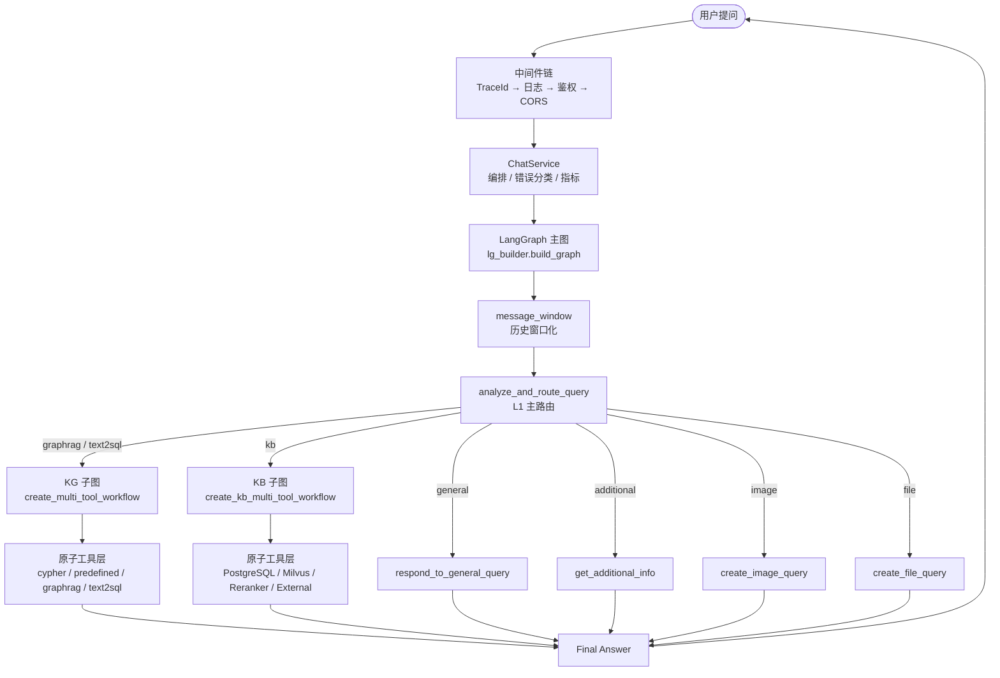

# My Agentix 架构文档

> 面向 **贡献者 / 二次开发者 / 架构评审** 的技术文档集。
> 若你只是想运行项目，请先看 [`../guides/QUICK_START.md`](../guides/QUICK_START.md)；若想了解产品定位，请看根目录 [`README.md`](../../README.md)。

---

## 1. 一句话架构

My Agentix 是一个**以 Agent 内核 + RAG 等多路检索为核心的综合服务平台**：以「**分层 + 依赖倒置 + 可插拔注册表**」组织代码，
以「**三层 Multi-Agent**」组织运行时（主路由层 → 多工具子图层 → 原子工具层），
以「**领域适配**」保持可迁移性（法律 → 中医药典 → 政务服务 … 等参考领域均可接入）。

---

## 2. 文档导航

| 文档 | 内容 | 适合谁 |
|------|------|--------|
| [**layers.md**](layers.md) | 分层架构、模块职责、**依赖规则**（含自动化守卫） | 所有贡献者（必读） |
| [**interfaces.md**](interfaces.md) | 端口抽象（Protocol）、Payload 契约、工具/Provider 接口定义 | 二次开发者 |
| [**extension.md**](extension.md) | **如何扩展**：新增工具 / Provider / Agent 子图 / 新领域 | 扩展开发者 |
| [**configuration.md**](configuration.md) | 配置管理：单一事实来源、分层覆盖、敏感项、启动自检 | 运维 / 部署者 |
| [**runtime-guardrails.md**](runtime-guardrails.md) | 运行时护栏：**上下文隔离 · 控制平面 · 感知工具限量 · 人工审批** | 运维 / 扩展开发者 |
| [**../design/orchestration-rationale.md**](../design/orchestration-rationale.md) | 逐环节「为何用自主 Agent 而非 Workflow」的论证 | 架构评审 |
| [**../design/design-legal-domain.md**](../design/design-legal-domain.md) | 法律领域设计（图谱 Schema、领域知识） | 领域适配者 |
| [**../VERSIONING.md**](../VERSIONING.md) | 版本管理与发布策略 | 维护者 |

---

## 3. 设计原则

本项目遵循以下五条贯穿性原则，所有架构决策均可回溯到其中一条：

| # | 原则 | 落地方式 | 守卫 |
|---|------|---------|------|
| 1 | **分层与依赖倒置** | `interfaces → application → domain ← infrastructure`，依赖指向抽象 | `tests/test_p17_domain_layer.py` |
| 2 | **单一事实来源** | 配置集中在 `agentix/config/settings.py`；工具声明集中在 `agentix/tools/registry_init.py`；prompt 集中在 `agentix/application/agents/lg_prompts.py` 与各子图 `prompts.py` | `tests/test_p23_prompt_externalization.py` |
| 3 | **可插拔与开闭** | 新增能力通过注册表声明，不改动调用链 | `tests/test_p13_registry.py` |
| 4 | **显式失败与降级** | 错误分类（`domain/errors.py`）+ 每层兜底；绝不静默吞异常 | `tests/test_p03_p04_errors_observability.py` |
| 5 | **可观测与可评估** | `trace_id` 全链路贯穿；评估集量化行为回归 | `evals/` + `tests/test_p21_eval_harness.py` |

---

## 4. 运行时架构（三层 Multi-Agent）



| 层 | 职责 | 关键模块 |
|----|------|---------|
| **L1 主路由层** | 意图识别与分发（启发式 + LLM 双保险） | `application/agents/router.py` |
| **L2 多工具子图层** | 任务分解、工具选择、并行执行、结果融合 | `.../workflows/multi_agent/` |
| **L3 原子工具层** | 具体检索/查询工具 | `.../components/*/node.py` |

> 每个自主环节「为何不能用确定性 Workflow 替代」的逐条论证，见 [`../design/orchestration-rationale.md`](../design/orchestration-rationale.md)。

---

## 5. 代码分层地图

```
agentix/
├── config/          配置（Pydantic Settings）——唯一事实来源
├── domain/          领域层：零外部依赖
│   ├── errors.py      错误词汇表（ErrorCode / AgentError）
│   ├── status.py      响应状态枚举（RequestStatus）
│   ├── tracing.py     trace_id ContextVar
│   ├── agent/         Agent 领域类型与端口（types / ports）
│   ├── runtime/       Runtime 状态契约（RunState / 终态集）
│   ├── tool/          ToolSpec 与风险分级（纯契约）
│   ├── policies/      判定函数（错误分类 / 重试策略 / 冲突仲裁）
│   └── ports/         抽象接口（Protocol）+ Payload TypedDict
├── application/     应用层：编排与业务规则
│   ├── agents/        LangGraph 业务节点、子图 prompt、LLM 工厂
│   └── services/      会话 / 记忆 / 观测 / 任务队列 / 请求作用域
├── orchestration/   编排层：AgentLoop 主循环 + LangGraph 图结构 + 多智能体策略
├── policies/        横切策略执行件：Planner / Verifier / HITL / Guardrails
├── tools/           工具层：注册面（definitions/registry_init/selection）
│   ├── gateway/       执行三闸 / 结果裁剪 / 人工复核 / KG 收编
│   └── adapters/      内置工具实现
├── agent/           Context Provider 家：context / memory / events / hooks / skills / evolution
├── runtime/         Agent Runtime：步骤 / 预算 / 生命周期 / 控制平面
├── capabilities/    能力层：mcp/（MCP 协议实现）
├── retrieval/       检索域垂直切片（api / domain / infra / usecases + 专属配置）
├── infrastructure/  基础设施层：实现 domain.ports
│   ├── llm/           LLM 调用加固（重试）
│   ├── persistence/   数据库 / 仓储实现 / Checkpointer
│   ├── text2sql/      Wren 文本转 SQL 适配器
│   └── core/          日志 / 安全 / 限流
├── observability/   Prometheus 指标与 OTel 链路
├── reliability/     熔断 / 限流 / 并发原语
├── security/        输入过滤 / PII 脱敏 / 越权检测
├── crawler/         知识库语料爬取/导入
└── interfaces/      接口层：协议转换
    └── http/          HTTP 路由、请求/响应模型、中间件
```

各层职责、允许的依赖方向与例外，见 [**layers.md**](layers.md)。

---

## 6. 关键横切能力

| 能力 | 实现 | 说明 |
|------|------|------|
| **可观测性** | `application/services/observability.py` + `request_scope.py` | LLM 调用明细 + 请求级聚合（token / 工具 / 成本） |
| **错误分类** | `domain/errors.py` + `domain/policies/error_classification.py` | 四层故障分类，各自兜底 |
| **重试** | `domain/policies/retry.py`（`aretry`） | 指数退避 + 抖动；错误路径不递归调模型 |
| **状态持久化** | `infrastructure/persistence/checkpointer.py` | Redis Checkpointer（三级降级） |
| **上下文管理** | `message_window` 节点 + `long_term_memory` | 历史窗口化 + 长期记忆（含时效衰减） |
| **安全** | `interfaces/http/v1/upload.py` + Cypher 只读闸门 | 见 [SECURITY.md](../../SECURITY.md) |
| **评估** | `evals/` | 102 条 golden（7 类路由 / 6 个出口节点 / 13 条越界）+ 5 个确定性打分函数 |

---

## 7. 如何开始贡献

1. 读 [**layers.md**](layers.md) 了解依赖规则（这是最容易被 CI 拦下的地方）
2. 读 [**extension.md**](extension.md) 找到你的扩展点
3. 按 [CONTRIBUTING.md](../../CONTRIBUTING.md) 的流程提交

---

## 8. 架构决策记录 (ADR)

重大架构决策记录在 [`adr/`](adr/) 目录，命名格式 `NNNN-<slug>.md`。

| ADR | 决策 |
|-----|------|
| [0001](adr/0001-layered-architecture-with-ports.md) | 采用分层架构 + 端口抽象（依赖倒置） |
| [0002](adr/0002-registry-based-plugin-mechanism.md) | 采用注册表驱动的可插拔扩展机制 |
| [0003](adr/0003-declarative-configuration-single-source.md) | 配置声明单一事实来源（Pydantic Settings） |
