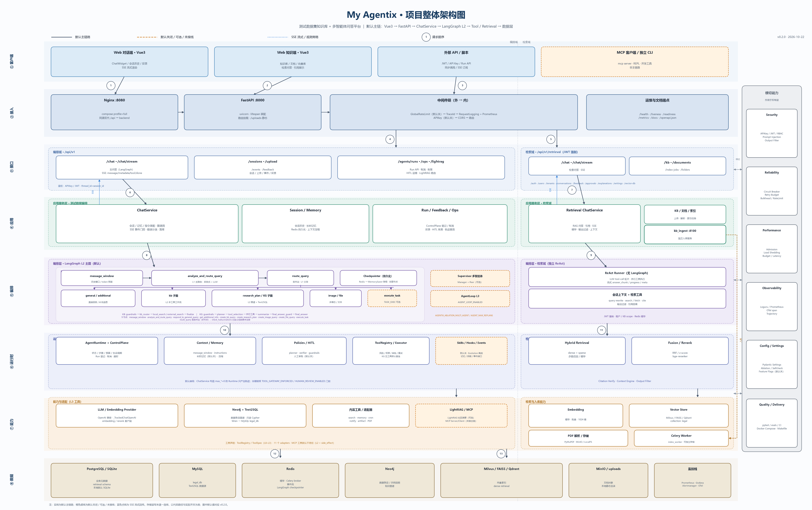
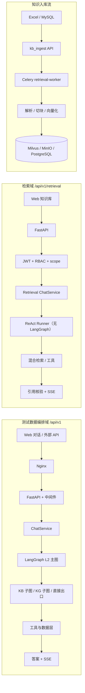
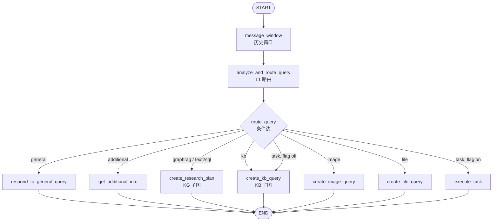

# My Agentix 项目全景与整体结构

> **版本**：v0.2.0 ｜ **更新日期**：2026-10-22 ｜ **适用读者**：新人、贡献者、二次开发者、架构评审
>
> 本文回答三个问题：**项目由哪些部分组成**、**一次请求如何流动**、**哪些能力默认开启、哪些只是可选/未接线**。
> 实现级细节（符号、默认值、失败语义）以 [`../PROJECT_SPEC.md`](../PROJECT_SPEC.md) 为准；三层多智能体的设计论证见 [`ARCHITECTURE_DETAIL.md`](ARCHITECTURE_DETAIL.md)；分层规则原文见 [`layers.md`](layers.md)。

---

## 目录

1. [项目定位](#1-项目定位)
2. [一张图看全貌](#2-一张图看全貌)
3. [三条端到端数据流](#3-三条端到端数据流)
4. [代码目录与模块职责](#4-代码目录与模块职责)
5. [测试数据编排域：请求链路](#5-测试数据编排域请求链路)
6. [LangGraph 主图与子图](#6-langgraph-主图与子图)
7. [检索域与知识入库](#7-检索域与知识入库)
8. [Runtime、工具治理与上下文](#8-runtime工具治理与上下文)
9. [数据、部署与配置](#9-数据部署与配置)
10. [默认开关与能力矩阵](#10-默认开关与能力矩阵)
11. [扩展点](#11-扩展点)
12. [质量保障与关键代码索引](#12-质量保障与关键代码索引)
13. [延伸阅读](#13-延伸阅读)

---

## 1. 项目定位

My Agentix 是一个**以 Agent 内核 + 多路检索为核心的综合服务平台**：后端用 FastAPI，编排用 LangGraph，前端用 Vue 3，领域默认适配测试数据集知识库，同时保留向中医药典、政务服务等领域迁移的适配层。

它不是一个「单轮 RAG Demo」，而是同时包含：

- **两套彼此独立的问答域**：测试数据编排域、检索域；
- **一条独立的知识入库流水线**：`kb_ingest` 服务 + Celery worker；
- **一套可灰度、可降级的运行时**：Agent Runtime、Control Plane、工具网关、Feature Flags；
- **一套工程化护栏**：分层依赖守卫、文档一致性守卫、评测集与质量门禁。

### 1.1 两套问答域 + 一条入库流

| 主线 | 入口 | 控制流 | 默认鉴权 | 主要存储 |
|---|---|---|---|---|
| **测试数据编排域** | `/api/v1/chat`、`/api/v1/chat/stream` | LangGraph L2 扁平图 → KB/KG 子图 → 原子工具 | API Key（默认关闭） | PostgreSQL / SQLite、Redis、Neo4j、Milvus |
| **检索域** | `/api/v1/retrieval/chat`、`/api/v1/retrieval/chat/stream` | 独立 ReAct 工具循环（**不经过 LangGraph**） | 路由级 JWT 强制 + RBAC/租户/知识库作用域 | PostgreSQL、Milvus、MinIO |
| **知识入库流** | `kb_ingest` 独立服务（容器内 8000，宿主机 8100） | FastAPI 接收任务 → Celery worker 解析/切块/向量化 | 服务级配置 | MySQL（源）、Milvus、MinIO、PostgreSQL |

> **关键区别**：测试数据编排域与检索域共享基础设施和部分检索能力，但**不是同一条链**。测试数据域走 LangGraph，检索域走自带的 ReAct 循环；两者的 SSE 事件名、会话模型、鉴权方式都不同。阅读代码时不要把它们混为一谈。

### 1.2 默认主链路与可选能力

项目的默认形态刻意保持「轻」：

- **默认主链路**：`Vue3 → Nginx → FastAPI → ChatService → LangGraph L2 → KB/KG 子图/工具 → 数据层`。
- **默认关闭**：AgentLoop L3、Supervisor 多智能体、任务执行、HITL 人工审批、Skills/Hooks、工具网关强制、限流/准入/甩载、Cron、多智能体总线、Agentic RAG 等。
- **已实现但未接入主链**：MCP Client/Server（`agentix/capabilities/mcp/`）、`check_hallucinations` 节点、LightRAG 的部分可选能力。

这不是「没做完」，而是**灰度与字节等价的工程选择**：默认关闭的能力必须保证 flag-off 时行为与基线一致；任何新增能力都要能被单独回滚。完整开关口径见 [`configuration.md`](configuration.md) 与第 10 节。

### 1.3 技术栈

| 类别 | 技术 |
|---|---|
| 后端 | Python 3.10–3.13、FastAPI、Uvicorn、SSE |
| Agent 编排 | LangGraph 0.2（主图 + KB/KG 子图）、Agent Runtime、AgentLoop |
| 前端 | Vue 3、TypeScript、Vite、Vitest |
| 知识存储 | PostgreSQL / SQLite、MySQL、Redis、Neo4j、Milvus / FAISS / Qdrant |
| 检索增强 | 向量检索、BM25/稀疏通道、RRF 融合、Reranker、引用核验 |
| 工具扩展 | ToolRegistry、ToolExecutor、MCP Client/Server、Skills |
| 可观测 | Loguru、Prometheus、OpenTelemetry、轨迹落盘与回放 |
| 交付 | Docker Compose、GitHub Actions、Makefile、pytest / ruff |

---

## 2. 一张图看全貌



> 图片同时提供 [SVG 矢量版](../assets/project-architecture.svg)；可编辑源文件为 [`project-architecture.mmd`](project-architecture.mmd)，Matplotlib 生成脚本为 [`../design/generate_project_architecture.py`](../design/generate_project_architecture.py)。

**图例**：

| 线型/颜色 | 含义 |
|---|---|
| 实线 + 深色边框 | 默认主链路（flag-off 也能工作） |
| 橙色虚线 + 橙色边框 | 默认关闭 / 可选 / 已实现但未接线 |
| 蓝色点线 | SSE 流式通道 / 观测旁路 |
| 右侧「横切能力」栏 | 作用于所有层的安全、可靠性、性能、可观测、配置与交付能力 |

**读图顺序建议**：

1. 先看最上方「客户端 → 接入 → 接口」三段，确认请求从哪进来；
2. 再看中间「应用服务 → 编排」两段，确认默认走 LangGraph L2 还是检索 ReAct；
3. 最后看下方「运行时 / 能力与适配 / 数据」三段，确认依赖了哪些外部系统；
4. 橙色框只代表「可选项」，不要在默认部署里假设它们已启用。

---

## 3. 三条端到端数据流



| 维度 | 测试数据编排域 | 检索域 | 入库流 |
|---|---|---|---|
| 是否用 LangGraph | 是（L2 扁平图；可选 L3 AgentLoop） | 否（自建 ReAct 循环） | 否 |
| 会话标识 | `session_id` → `thread_id` | 会话 + 用户 + 知识库作用域 | 任务/文档 ID |
| 流式协议 | `metadata` / `message` / `tool_start` / `tool_end` / `done` / `error` | `meta` / `progress` / `tool_running` / `answer_chunk` / `error` | 任务状态轮询/回调 |
| 主要鉴权 | API Key（默认关闭） | JWT 强制 + RBAC | 服务配置 |
| 典型存储 | PostgreSQL / Redis / Neo4j / Milvus | PostgreSQL / Milvus / MinIO | MySQL / Milvus / MinIO / PostgreSQL |

---

## 4. 代码目录与模块职责

### 4.1 顶层目录

```text
My-Agentix/
├── agentix/                后端主包：FastAPI 应用 + Agent 平台内核
├── kb_ingest/              知识库入库独立服务（API / Celery worker / 解析与向量化）
├── web/                    Vue 3 前端（对话工作台 + 知识库管理）
├── evals/                  黄金评估集、离线评测、质量门禁、消融与轨迹回归
├── tests/                  后端回归、API 集成、架构守卫、文档一致性守卫
├── scripts/                数据构建、迁移、运维与压测脚本
├── skills/                 Agent Skills 目录（默认关闭）
├── docker/                 Prometheus / Alertmanager / Grafana 等观测栈配置
├── docs/                   架构、指南、Runbook、ADR、项目说明书与资产
├── data/                   领域数据与运行时数据（不保证入库）
├── uploads/                上传文件目录（运行时生成）
├── archive/                历史归档
├── docker-compose.yml      本地/演示编排
├── Dockerfile              后端镜像
├── Makefile                常用开发与质量命令
├── pyproject.toml          Python 项目与工具链配置
├── run.py                  本地启动入口
└── start_chatbot.py        对话启动入口
```

### 4.2 `agentix/` 子包职责

| 子包/文件 | 职责 | 关键入口 |
|---|---|---|
| `agentix/main.py` | FastAPI 入口：中间件链、路由挂载、静态托管、启动自检与接线 | `lifespan`、`_startup` |
| `config/` | Pydantic Settings 单一事实来源、启动自检、消融开关 | `settings.py`、`selfcheck.py` |
| `domain/` | 领域层：错误词汇、状态、trace_id、Agent/Runtime/Tool 契约、端口 Protocol、纯判定函数 | `errors.py`、`ports/`、`policies/` |
| `orchestration/` | 编排件：主循环、执行器、LangGraph 图结构、多智能体策略 | `langgraph/lg_builder.py`、`strategies/multi_agent` |
| `policies/` | 横切策略件：Planner、Verifier、HITL、Guardrails | `planner/`、`verifier/`、`hitl/`、`guardrails/` |
| `tools/` | 工具唯一执行入口：注册面、选择、网关、适配器 | `registry_init.py`、`gateway/executor.py` |
| `application/` | 应用层：业务节点、KB/KG 子图、ChatService、会话/记忆/观测/任务 | `services/chat_service.py`、`agents/` |
| `agent/` | Context Provider 家：context、memory、events、hooks、skills、evolution、observer、policy | `context/`、`memory/`、`events/` |
| `runtime/` | Agent Runtime 真源：状态、步骤、预算、生命周期、控制平面 | `control_plane.py`、`budget.py` |
| `performance/` | 运行性能治理：延迟、预算、准入排队、负载降级 | `performance/` |
| `capabilities/` | 能力层：MCP 协议、客户端与零依赖 stdio server | `mcp/` |
| `infrastructure/` | 基础设施层：LLM、持久化、缓存、HTTP、Text2SQL、数据库、日志、限流 | `llm/`、`persistence/`、`core/` |
| `interfaces/` | 接口层：HTTP 路由、请求/响应模型、中间件 | `http/v1/`、`http/ops_router.py` |
| `retrieval/` | 检索域垂直切片：API、领域模型、基础设施、用例、自带 ReAct 控制流 | `api/routers/chat.py`、`usecases/chat_agent_runner.py` |
| `observability/` | Prometheus 指标、OTel 链路、轨迹落盘 | `metrics.py`、`tracing.py` |
| `reliability/` | 熔断、限流、并发原语 | `reliability/` |
| `security/` | 输入过滤、PII 脱敏、越权检测 | `security/` |
| `crawler/` | 知识库语料爬取/导入 CLI | `crawler/` |

> 依赖方向是硬规则：`interfaces → application → domain ← infrastructure`。`domain/` 不依赖第三方库，`application/` 不直接 import `infrastructure/`。完整规则与例外见 [`layers.md`](layers.md)。

### 4.3 前端结构

```text
web/src/
├── api/
│   └── sse.ts              统一 SSE 解析器（测试数据域 + 检索域共用）
├── components/             跨模块通用组件
├── modules/
│   ├── chat/               测试数据对话工作台：聊天、会话、上传、执行轨迹
│   │   ├── App.vue
│   │   ├── api/
│   │   ├── components/
│   │   └── styles/
│   └── knowledge/          知识库管理：文档、检索、租户/用户、索引任务
│       ├── api/
│       ├── auth/
│       ├── components/
│       ├── composables/
│       ├── router/
│       ├── types/
│       ├── utils/
│       └── views/
└── router/                 应用级路由
```

前端由 Nginx 托管 `dist`，并将 `/api` 反向代理到后端；SSE 解析集中在 `web/src/api/sse.ts`，避免两套页面各自实现一套流式协议。

### 4.4 独立入库服务

```text
kb_ingest/
├── kb_service/
│   ├── api/                入库与检索 HTTP 路由
│   ├── clients/            MySQL / LLM / Milvus / MinIO 等客户端
│   ├── core/               配置与核心类型
│   ├── db/                 数据库访问
│   ├── prompts/            入库相关提示词
│   ├── schemas/            请求/响应模型
│   └── services/           解析、切块、向量化、索引服务
└── data/                   入库示例数据
```

`kb_ingest` 是**独立进程**，不嵌在 `agentix` 的 FastAPI 应用里；它通过 Celery worker 处理重 IO 的解析与向量化任务，避免阻塞在线问答。

---

## 5. 测试数据编排域：请求链路

### 5.1 请求路径

```text
浏览器 / 外部 API
   ↓
Nginx（web 容器，托管前端并代理 /api）
   ↓
FastAPI（agentix/main.py，uvicorn）
   ↓
中间件链（执行顺序，外 → 内）
   GlobalRateLimit → TraceId → RequestLogging/Prometheus → APIKey → CORS
   ↓
/api/v1/chat  或  /api/v1/chat/stream
   ↓
ChatService
   ├── 会话/记忆读写
   ├── AgentRuntime 运行登记（预算仅用于轨迹）
   └── LangGraph 图调用（thread_id = session_id）
          ↓
      route_query（条件边）
          ├── general-query       → respond_to_general_query
          ├── additional-query    → get_additional_info
          ├── graphrag/text2sql   → create_research_plan → KG 子图
          ├── kb-query            → create_kb_query → KB 子图
          ├── image-query         → create_image_query
          ├── file-query          → create_file_query
          └── task-query          → execute_task（需 TASK_EXEC_ENABLED）
   ↓
答案 + SSE 事件
```

### 5.2 关键实现点

| 环节 | 实现位置 | 说明 |
|---|---|---|
| 应用入口 | `agentix/main.py` | 中间件、路由、静态文件、启动自检与可选能力接线 |
| 对话路由 | `agentix/interfaces/http/v1/chat.py` | `/chat` 与 `/chat/stream` |
| 业务编排 | `agentix/application/services/chat_service.py` | `ask`、`stream_events`、会话、运行登记、超时与并发信号量 |
| 图构建 | `agentix/orchestration/langgraph/lg_builder.py` | `build_graph` 构建 L2 扁平图，`get_active_graph` 选择可选拓扑 |
| 路由判定 | `agentix/application/agents/router.py` | `route_query` 条件边：启发式 + LLM 双保险 |
| 状态契约 | `agentix/orchestration/langgraph/lg_states.py` | `AgentState` 与消息/上下文状态 |
| 持久化 | `agentix/infrastructure/persistence/checkpointer.py` | Redis `AsyncRedisSaver`，失败降级 `MemorySaver` |
| 运行控制 | `agentix/runtime/control_plane.py` | Run 登记、取消、超时打断 |

### 5.3 `ask` 与 `stream` 的差异

| 维度 | `ask` | `stream` / `stream_events` |
|---|---|---|
| 默认编排 | LangGraph L2 扁平图 | LangGraph L2 扁平图 |
| 可选 L3 | `AGENT_LOOP_ENABLED=True` 时走 AgentLoop | 始终 L2，不受 L3 开关影响 |
| 返回形态 | 一次性结果（含状态、消息、指标） | SSE 增量事件 |
| 典型用途 | API 调用、Cron/任务、内部服务 | Web 对话工作台 |

> **注意**：`AGENT_LOOP_ENABLED` 只影响 `ask` 的编排选择；不要把「L3 开关」误读成「流式也走 AgentLoop」。

### 5.4 SSE 事件（测试数据域）

| 事件 | 含义 |
|---|---|
| `metadata` | 请求/会话/运行元信息 |
| `message` | 文本增量或完整消息 |
| `tool_start` | 工具开始执行 |
| `tool_end` | 工具执行结束（含结果摘要/状态） |
| `done` | 本轮完成 |
| `error` | 本轮失败（错误分类后的对外信息） |

前端统一由 `web/src/api/sse.ts` 解析，避免在不同页面重复实现断线、分包与事件分发。

### 5.5 Checkpointer 与会话

- 默认使用 Redis Checkpointer（`AsyncRedisSaver`）；Redis 不可用或未配置时降级为 `MemorySaver`。
- 图调用时 `thread_id = session_id`，因此同一会话的多轮消息可以恢复图状态。
- Redis Checkpointer 依赖 Redis Stack 能力；生产环境应显式验证连通性与持久化配置。
- `MemorySaver` 只适合开发/演示，进程重启即丢失。

---

## 6. LangGraph 主图与子图

### 6.1 默认 L2 扁平图

`build_graph(checkpointer=None)` 注册 **9 个节点**（顺序为代码注册顺序，不代表执行顺序）：

| # | 节点 | 职责 | 备注 |
|---|---|---|---|
| 1 | `message_window` | 历史消息窗口化 | `MAX_HISTORY_MESSAGES`、`LG_TOKEN_HISTORY_BUDGET` 控制 |
| 2 | `analyze_and_route_query` | L1 主路由：意图识别 | 启发式 + LLM |
| 3 | `respond_to_general_query` | 通用问答出口 | general-query |
| 4 | `get_additional_info` | 补充信息出口 | additional-query |
| 5 | `create_research_plan` | 进入 KG 子图 | graphrag-query / text2sql-query |
| 6 | `create_image_query` | 图片查询出口 | image-query |
| 7 | `create_file_query` | 文件查询出口 | file-query |
| 8 | `create_kb_query` | 进入 KB 子图 | kb-query |
| 9 | `execute_task` | 任务执行入口 | 仅在 `TASK_EXEC_ENABLED=True` 时可达 |

> **两个容易误读的点**：
> 1. `route_query` 是**条件边/路由函数**，不是节点，不计入 9 个节点。
> 2. `check_hallucinations` 在代码中有定义，但**故意未注册**到主图（DEAD-CODE P2-5），不要把它画成主链节点。

### 6.2 路由映射

| 路由类型 | 目标节点 | 说明 |
|---|---|---|
| `general-query` | `respond_to_general_query` | 通用问答 |
| `additional-query` | `get_additional_info` | 需要补充信息 |
| `graphrag-query` | `create_research_plan` | 进入 KG 子图 |
| `text2sql-query` | `create_research_plan` | 进入 KG 子图的 Text2SQL 分支 |
| `image-query` | `create_image_query` | 图片查询 |
| `file-query` | `create_file_query` | 文件查询 |
| `kb-query` | `create_kb_query` | 进入 KB 子图 |
| `task-query` | `execute_task`（flag 开） / `create_kb_query`（flag 关） | 任务执行需显式开启 |

此外，请求中显式提供 `image_path` / `file_path` 时，路由会优先按对应类型处理，覆盖自动判定的结果。

### 6.3 主图 Mermaid



### 6.4 KB 子图

入口：`create_kb_query` → `create_kb_multi_tool_workflow`。

| 节点 | 职责 |
|---|---|
| `guardrails` | 输入/越界防护，决定是否直接拒答 |
| `kb_router` | 选择本地检索 / 外部检索 |
| `local_search` | 本地知识库检索（向量 + 关键词/混合） |
| `external_search` | 外部检索兜底 |
| `finalize` | 结果融合、引用与最终答案 |

执行路径：

```text
START → guardrails → kb_router
                    ├── local_search ──→ finalize → END
                    └── external_search → finalize → END
```

### 6.5 KG 子图

入口：`create_research_plan` → `create_multi_tool_workflow`。

| 节点 | 职责 |
|---|---|
| `guardrails` | 越界与安全检查 |
| `planner` | 研究计划/工具选择规划 |
| `tool_selection` | 选择本轮要执行的工具 |
| `cypher_query` | Neo4j Cypher 查询 |
| `predefined_cypher` | 预定义 Cypher 查询 |
| `customer_tools` | 自定义工具（含 LightRAG 等） |
| `text2sql_query` | Text2SQL 查询 |
| `summarize` | 工具结果汇总 |
| `final_answer_guard` | 最终答案护栏/校验 |
| `final_answer` | 生成最终答案 |
| `error_tool_selection` | 工具选择失败的错误出口 |

执行路径：

```text
START → guardrails → planner → tool_selection
                                  ├── cypher_query / predefined_cypher / customer_tools / text2sql_query
                                  └── error_tool_selection
工具节点 → summarize → final_answer_guard → final_answer → END
```

### 6.6 可选拓扑

| 拓扑 | 开关 | 生效范围 | 说明 |
|---|---|---|---|
| Supervisor 多智能体 | `AGENTIX_ABLATION_MULTI_AGENT=true` | `get_active_graph()` | Manager + Peer；默认仍用扁平图 |
| AgentLoop L3 | `AGENT_LOOP_ENABLED=true` | 仅 `ask` | 自主循环/规划纠偏；`stream` 仍走 L2 |
| 任务执行 | `TASK_EXEC_ENABLED=true` | `route_query` | 使 `execute_task` 可达 |
| 图内 HITL | `HITL_IN_LOOP_ENABLED=true` | `execute_task` | 需要 checkpointer 与审批面 |

这些开关都遵循「flag-off 等价基线」：默认关闭时，图结构、路由结果与响应语义保持与基线一致。

---

## 7. 检索域与知识入库

### 7.1 检索域请求链

```text
Web 知识库 / API
   ↓
FastAPI
   ↓
/api/v1/retrieval/*（路由级 JWT 强制 + RBAC + 租户/知识库作用域）
   ↓
Retrieval ChatService
   ↓
ReAct Runner（自建工具循环，不经过 LangGraph）
   ├── 工具选择与调用
   ├── 混合检索（dense + sparse/BM25）
   ├── RRF 融合
   ├── Rerank
   └── 引用核验
   ↓
答案 + 引用 + SSE
```

**关键实现**：

- 路由文件：`agentix/retrieval/api/routers/chat.py`
- 控制流：`agentix/retrieval/usecases/chat_agent_runner.py` 的 `run_agent_stream`
- 检索配置：`agentix/retrieval/settings.py`
- 前端 API 与 SSE：`web/src/modules/knowledge/api/`、`web/src/api/sse.ts`

**内置检索工具**（以代码注册为准）：

- `count_scope_documents`
- `list_scope_documents`
- `lookup_scope_document`
- `query_knowledge_base`
- `search_documents`

**SSE 事件（检索域）**：

| 事件 | 含义 |
|---|---|
| `meta` | 请求/会话/作用域元信息 |
| `progress` | 阶段进度 |
| `tool_running` | 工具调用中 |
| `answer_chunk` | 答案增量 |
| `error` | 错误 |

> 检索域与测试数据域的 SSE 事件名不同，前端不能共用同一套事件分发逻辑；共用的只是底层解析器 `web/src/api/sse.ts`。

### 7.2 检索域与测试数据域的区别

| 维度 | 测试数据编排域 | 检索域 |
|---|---|---|
| 控制流 | LangGraph 主图 + 子图 | 自建 ReAct 工具循环 |
| 鉴权 | API Key（默认关闭） | JWT 强制 + RBAC + scope |
| 会话 | `session_id` + checkpointer | 会话/用户/知识库作用域 |
| 工具 | ToolRegistry + ToolExecutor + KG/KB 子图 | 检索用例内注册的工具 |
| 流式事件 | `metadata/message/tool_start/tool_end/done/error` | `meta/progress/tool_running/answer_chunk/error` |
| 典型入口 | `web/src/modules/chat/` | `web/src/modules/knowledge/` |

### 7.3 知识入库流

`kb_ingest` 是独立 FastAPI 服务，路由在 `kb_ingest/kb_service/api/routes.py`：

| 方法/路径 | 用途 |
|---|---|
| `POST /ingest/excel` | 按主机本地路径读取 Excel 并入库 |
| `POST /ingest/excel/upload` | 上传 Excel 并入库 |
| `POST /ingest/mysql` | 从 MySQL 拉取数据并入库 |
| `POST /search` | 向量检索 |
| `POST /search/hybrid` | 混合检索 + 重排 |

处理链路：

```text
Excel / MySQL
   ↓
kb_ingest API（任务接收、参数校验）
   ↓
Celery retrieval-worker
   ↓
解析 → 切块 → Embedding → 写入 Milvus
   ↓
原文/附件 → MinIO；任务与元数据 → PostgreSQL
```

**边界提醒**：

- `/ingest/excel` 接受调用方给出的主机路径，属于运维便利接口；生产环境应配合网络隔离与访问控制。
- 入库是重 IO 任务，不应在在线问答进程内同步执行。
- Milvus / MinIO / MySQL 任一不可用时，入库任务应显式失败并保留可重试状态，而不是静默丢弃。

---

## 8. Runtime、工具治理与上下文

### 8.1 Agent Runtime 组件

| 组件 | 位置 | 职责 |
|---|---|---|
| `AgentRuntime` | `agentix/runtime/` | Run 生命周期、步骤推进、状态收敛 |
| `BudgetManager` | `agentix/runtime/budget.py` | 步数/LLM/工具/token/延迟/成本预算判定 |
| `LifecycleManager` | `agentix/runtime/` | 统一退出契约与终态判定 |
| `ControlPlane` | `agentix/runtime/control_plane.py` | Run 登记、取消、超时打断 Task |
| `ContextEngine` | `agentix/agent/context/engine.py` | 上下文拼装、压缩、隔离与预算 |
| `Memory` | `agentix/agent/memory/` | 长期记忆、记忆卡、向量召回、画像 |
| `Policies` | `agentix/policies/` | Planner、Verifier、HITL、Guardrails |
| `ToolRegistry` / `ToolExecutor` | `agentix/tools/` | 工具声明、选择、权限/风险/审批/超时/重试 |
| `Skills` / `Hooks` / `Events` | `agentix/agent/` | 技能、生命周期钩子、事件总线 |

> **预算口径**：测试数据聊天主链路构造 `AgentRuntime` 时使用全 0 预算（`max_steps=0`、`max_llm_calls=0`、`max_tool_calls=0`、`max_tokens=0`、`max_latency_ms=0`、`max_cost_usd=0.0`），预算不参与拦截，仅用于运行登记与轨迹观测；实际超时由 `AGENT_TIMEOUT` 与调用层控制。需要硬预算时应在具体运行入口显式传入非零值。

### 8.2 工具治理

`ToolExecutor` 的执行链：

```text
权限校验 → 风险分级 → 人工审批（可选） → 超时 → 重试 → 执行 → 结果裁剪 → 审计/日志 → 轨迹
```

| 概念 | 说明 |
|---|---|
| `ToolSpec` | 工具声明：名称、参数、风险等级（L0–L3）、`side_effect`、权限要求 |
| `ToolRegistry` | 注册表单例；新增工具在 `agentix/tools/registry_init.py` 声明 |
| `ToolExecutor` | 唯一执行入口；负责权限、风险、审批、超时、重试、结果裁剪 |
| `TOOL_GATEWAY_ENFORCED` | 默认 `False`；为 `False` 时 5 个 KG 工具走直连路径 |
| `HUMAN_REVIEW_ENABLED` | 默认 `False`；开启后接入 HITL 审批桥 |
| HITL | 审批面在 `agentix/policies/hitl/`；图内 HITL 由 `HITL_IN_LOOP_ENABLED` 控制 |

**MCP 状态**：

- 协议、客户端与零依赖 stdio server 已实现，位于 `agentix/capabilities/mcp/`。
- 默认**未接入主问答链**；MCP 工具默认按 `L2 + side_effect=True` 处理，接入时必须经过工具网关与审批策略。
- 不要把「MCP 已实现」误解为「默认已启用」。

### 8.3 上下文与记忆

| 能力 | 默认 | 说明 |
|---|---|---|
| 历史窗口 | 开启 | `message_window`，`MAX_HISTORY_MESSAGES=20` |
| 长期记忆注入 | 默认关 | `MEMORY_CONTEXT_ENABLED=False` |
| 记忆卡 | 默认开 | `MEMORY_CARDS_ENABLED=True` |
| 自动压缩 | 默认关 | `CONTEXT_AUTOCOMPACT=False` |
| 上下文隔离 | 可选 | 相关 flag 默认关，见 `runtime-guardrails.md` |
| 轨迹 | 默认内存 | `TRAJECTORY_SINK=memory`；落盘需显式配置 |

记忆与上下文的完整开关、预算和回滚口径，以 [`runtime-guardrails.md`](runtime-guardrails.md) 与 [`configuration.md`](configuration.md) 为准。

---

## 9. 数据、部署与配置

### 9.1 数据存储

| 存储 | 用途 | 默认/备注 |
|---|---|---|
| PostgreSQL / SQLite | 会话、用户、知识库元数据、运行记录 | `DATABASE_URL` 默认 SQLite；生产用 PostgreSQL |
| MySQL | `kb_ingest` 的上游业务数据源 | 仅入库流使用 |
| Redis | Checkpointer、缓存、限流、事件总线 | 默认 `redis://localhost:6379/0` |
| Neo4j | 测试数据知识图谱、Cypher 查询 | KG 子图依赖 |
| Milvus / FAISS / Qdrant | 向量检索 | 检索域默认 `faiss`，可切 Milvus |
| MinIO / 本地磁盘 | 上传文件、原文、附件 | `UPLOAD_DIR` 默认 `uploads` |
| Prometheus / Grafana / Alertmanager | 指标、看板、告警 | `docker/` 下配置 |

> `data/` 目录包含运行时产物（缓存、轨迹、任务文件等），**不入库、不保证存在**；文档不要把它当作稳定交付物引用。

### 9.2 Docker Compose 端口

| 服务 | 宿主机端口 → 容器端口 | 说明 |
|---|---|---|
| `backend` | `8000:8000` | FastAPI |
| `postgres` | `15432:5432` | PostgreSQL |
| `mysql` | `13306:3306` | MySQL（入库源） |
| `redis` | `6379:6379` | Redis |
| `neo4j` | `17474:7474`、`17687:7687` | Neo4j Browser / Bolt |
| `milvus` | `19530:19530`、`9091:9091` | Milvus SDK / metrics |
| `minio` | `9000:9000`、`9001:9001` | S3 API / Console |
| `kb_ingest` | `8100:8000` | 入库服务 |
| `reranker` | `127.0.0.1:7997:7997` | `reranker` profile |
| `web` | `8080:80` | `full` profile，Nginx + 前端 |
| `prometheus` | `9090:9090` | 指标抓取 |
| `alertmanager` | `9093:9093` | 告警 |
| `grafana` | `3000:3000` | 看板 |
| `retrieval-worker` | 无宿主机端口 | Celery worker |
| `etcd` | 无宿主机端口 | Milvus 依赖 |

启动方式与 profile 组合见 [`../guides/QUICK_START.md`](../guides/QUICK_START.md) 与仓库根 `docker-compose.yml`。

### 9.3 配置来源与启动校验

| 配置面 | 位置 | 说明 |
|---|---|---|
| 主配置 | `agentix/config/settings.py` | Pydantic Settings，单一事实来源 |
| 检索域配置 | `agentix/retrieval/settings.py` | 检索专属字段与生产校验 |
| 环境模板 | `.env.example` | 键集合与默认值说明（不提交真实密钥） |
| 启动自检 | `agentix/config/selfcheck.py` | 比对 `.env` 与模板字段集合，只告警不打印值 |
| 文档守卫 | `tests/test_p41_doc_consistency.py` | 配置键/路径/数字一致性 |

**启动行为**：

- 开发环境：配置校验的 error 只记录日志，不阻断启动。
- 生产环境（`PRODUCTION`）：配置校验出现 error 时**拒绝启动**，避免带错误语义对外服务。
- `REQUIRE_API_KEY` 默认 `False`，启动期会打印警告；生产必须显式开启并配置密钥。
- 检索域聊天路由自身强制 JWT/RBAC，不依赖 `V1_REQUIRE_JWT` 的默认值。

---

## 10. 默认开关与能力矩阵

> 下表只列「会改变主链路形态」的关键开关；完整键表、默认值与回滚方式见 [`configuration.md`](configuration.md)。所有开关默认值以 `Settings` 代码为准。

### 10.1 默认开启

| 开关 | 默认 | 影响 |
|---|---|---|
| `MEMORY_CARDS_ENABLED` | `True` | 记忆卡能力 |
| `PROMPT_INJECTION_DETECTION_ENABLED` | `True` | 提示注入检测 |
| `RERANK_ENABLED` | `True` | 检索结果重排 |
| 检索域 `OUTPUT_FILTER_ENABLED` | `True` | 输出过滤 |
| 检索域 `OUTPUT_FILTER_PII_ENABLED` | `True` | PII 脱敏 |
| 检索域 `VECTOR_STORE_BACKEND` | `faiss` | 默认向量后端 |

### 10.2 默认关闭 / 可选

| 开关 | 默认 | 打开后的效果 |
|---|---|---|
| `AGENT_LOOP_ENABLED` | `False` | `ask` 走 AgentLoop L3 |
| `TASK_EXEC_ENABLED` | `False` | `execute_task` 可达 |
| `AGENTIX_ABLATION_MULTI_AGENT` | `False` | 切换 Supervisor 多智能体拓扑 |
| `HUMAN_REVIEW_ENABLED` | `False` | 工具执行接入人工审批 |
| `TOOL_GATEWAY_ENFORCED` | `False` | KG 工具也强制走网关 |
| `SKILLS_ENABLED` | `False` | 装配 Skills |
| `HOOKS_ENABLED` | `False` | 装配生命周期 Hooks |
| `MEMORY_CONTEXT_ENABLED` | `False` | 长期记忆注入上下文 |
| `CONTEXT_AUTOCOMPACT` | `False` | 上下文自动压缩 |
| `RATE_LIMIT_ENABLED` | `False` | 全局限流中间件生效 |
| `ADMISSION_CONTROL_ENABLED` | `False` | 准入排队 |
| `LOAD_SHEDDING_ENABLED` | `False` | 过载甩载 |
| `RETRY_BUDGET_ENABLED` | `False` | 重试预算 |
| `FEEDBACK_ENABLED` | `False` | 用户反馈链路 |
| `NOTIFY_USER_ENABLED` | `False` | 用户通知 |
| `MULTIAGENT_BUS_ENABLED` | `False` | 多智能体事件总线 |
| `AGENTIC_RAG_ENABLED` | `False` | Agentic RAG 路径 |
| `KG_PLANNER_UNIFIED_ENABLED` | `False` | KG Planner 统一路径 |
| `V1_REQUIRE_JWT` | `False` | 测试数据域 V1 JWT 强制（检索域不受此开关影响） |
| `SSE_COALESCE_ENABLED` | `False` | SSE 合流/背压 |
| `MULTIAGENT_SUBAGENT_ISOLATION_ENABLED` | `False` | 子代理隔离 |
| `SUBAGENT_RESULT_CONTRACT_ENABLED` | `False` | 子代理结果契约 |

### 10.3 如何判断一个能力是否在默认链路里

按以下顺序检查，不要只看文档标题：

1. **看 `Settings` 默认值**：`agentix/config/settings.py` 与 `agentix/retrieval/settings.py`。
2. **看组合根是否接线**：`agentix/main.py` 的 `_startup` 是否在 flag 开启时装配。
3. **看图构建是否注册**：`agentix/orchestration/langgraph/lg_builder.py` 是否 `add_node` / `add_edge`。
4. **看调用点是否可达**：静态搜索函数/工具的引用；未注册、未调用的实现属于「已实现但未接线」。
5. **看守卫与测试**：`tests/test_p41_doc_consistency.py` 防文档漂移，分层守卫防依赖回潮。

---

## 11. 扩展点

| 我想扩展 | 首选落点 | 必须同步 |
|---|---|---|
| 新增工具 | `agentix/tools/registry_init.py` + `agentix/tools/adapters/` | ToolSpec、风险等级、权限、测试、配置文档 |
| 新增 LLM / Embedding Provider | `agentix/infrastructure/llm/` 或 Provider 注册面 | 配置键、工厂、降级路径 |
| 新增 Agent 子图 | `agentix/application/agents/kg_sub_graph/` + `lg_builder.py` | 节点、边、状态字段、路由出口、测试 |
| 新增领域 | 提示词、图谱 Schema、评测集、领域适配层 | 不要改内核依赖方向 |
| 新增 MCP Server | `agentix/capabilities/mcp/` | 协议、工具声明、网关与审批 |
| 新增检索工具 | `agentix/retrieval/usecases/` | 作用域校验、引用、SSE 进度 |
| 新增配置键 | `agentix/config/settings.py` / `agentix/retrieval/settings.py` | `.env.example`、selfcheck、configuration.md、p41 清单 |
| 新增前端页面 | `web/src/modules/` | 路由、API、SSE 解析、权限 |

扩展的完整步骤、目录归属决策树与反例见 [`extension.md`](extension.md) 与 [`layers.md`](layers.md)。

---

## 12. 质量保障与关键代码索引

### 12.1 测试与守卫

| 层面 | 内容 |
|---|---|
| 单元 / API 集成 | 路由、Reranker、上传安全、认证、LLM 工厂 |
| 架构守卫 | 分层依赖规则（AST 扫描 + 白名单集合相等）、模块迁移守卫 |
| 文档守卫 | 路径存在性、配置键存在性、golden 数字一致性、docx 路径一致性 |
| 运行时护栏 | 上下文隔离、控制平面、token 预算、目标裁定流程、工具限量、人工审批 |
| Agent Core | 主循环、规划纠偏、HITL、事件、多智能体失败模式、演化、分层验证 |
| 可观测性 | 轨迹回放、首错定位、Pass^k、轨迹前缀回归 |
| 检索 | 混合检索、引用核验、租户隔离、索引任务 |

### 12.2 评估集

| 指标 | 当前值 |
|---|---|
| golden 条数 | 102 |
| 路由类型 | 7 类 |
| 出口节点 | 6 个 |
| 越界拒答样本 | 13 条 |
| 确定性打分函数 | 5 个 |

评测入口与口径见 [`../../evals/README.md`](../../evals/README.md)。CI 包含 pytest、ruff、离线评测质量门禁、阻塞性能冒烟与 CodeQL；具体工作流以 `.github/workflows/` 为准。

### 12.3 关键代码索引

| 想找 | 文件 | 符号/说明 |
|---|---|---|
| 应用入口 | `agentix/main.py` | `application`、`lifespan`、`_startup` |
| 主配置 | `agentix/config/settings.py` | `Settings`、`settings` |
| 对话业务 | `agentix/application/services/chat_service.py` | `ChatService.ask`、`stream_events` |
| 图构建 | `agentix/orchestration/langgraph/lg_builder.py` | `build_graph`、`get_active_graph` |
| 图状态 | `agentix/orchestration/langgraph/lg_states.py` | `AgentState` |
| 路由 | `agentix/application/agents/router.py` | `route_query` |
| KB 子图 | `agentix/application/agents/kg_sub_graph/agentic_rag_agents/workflows/multi_agent/kb_workflow.py` | `create_kb_multi_tool_workflow` |
| KG 子图 | `agentix/application/agents/kg_sub_graph/agentic_rag_agents/workflows/multi_agent/multi_tool.py` | `create_multi_tool_workflow` |
| Checkpointer | `agentix/infrastructure/persistence/checkpointer.py` | `init_checkpointer` |
| 工具执行 | `agentix/tools/gateway/executor.py` | `ToolExecutor` |
| 工具注册 | `agentix/tools/registry_init.py` | 内置工具注册 |
| 检索聊天路由 | `agentix/retrieval/api/routers/chat.py` | `/chat`、`/chat/stream` |
| 检索 ReAct | `agentix/retrieval/usecases/chat_agent_runner.py` | `run_agent_stream` |
| 入库路由 | `kb_ingest/kb_service/api/routes.py` | `/ingest/*`、`/search*` |
| 前置 SSE | `web/src/api/sse.ts` | 统一 SSE 解析 |
| 测试数据前端 | `web/src/modules/chat/App.vue` | 对话工作台 |
| 检索前端 | `web/src/modules/knowledge/` | 知识库管理 |

---

## 13. 延伸阅读

| 文档 | 内容 |
|---|---|
| [`README.md`](README.md) | 架构文档导航、五条设计原则、运行时总览 |
| [`layers.md`](layers.md) | 分层职责、依赖硬规则、AST 守卫 |
| [`interfaces.md`](interfaces.md) | 端口 Protocol、Payload 契约、错误码 |
| [`extension.md`](extension.md) | 新增工具/Provider/子图/领域 |
| [`configuration.md`](configuration.md) | 配置键全表、覆盖顺序、回滚口径 |
| [`runtime-guardrails.md`](runtime-guardrails.md) | 上下文隔离、控制平面、工具限量、人工审批 |
| [`ARCHITECTURE_DETAIL.md`](ARCHITECTURE_DETAIL.md) | 三层多智能体设计详解与逐节点流程 |
| [`request-execution-graph.md`](request-execution-graph.md) | 请求执行图与关键路径 |
| [`../PROJECT_SPEC.md`](../PROJECT_SPEC.md) | 23 章实现级项目说明书 |
| [`../notebooks/README.md`](../notebooks/README.md) | 旧源码导读迁移说明与文档入口 |
| [`../guides/QUICK_START.md`](../guides/QUICK_START.md) | 启动、端口与常见问题 |
| [`../guides/testing.md`](../guides/testing.md) | 测试分层与「改动 → 测试」对照 |
| [`../../evals/README.md`](../../evals/README.md) | 评测集、打分函数、质量门禁 |

---

> **维护约定**：本文件是「整体结构」的单一入口。新增/删除顶层模块、改变默认主链路、增加重要可选能力时，必须同步更新本文件、[`../assets/project-architecture.png`](../assets/project-architecture.png)（及其 SVG/Mermaid 源）、[`README.md`](README.md) 与 [`../../README.md`](../../README.md)。文档中的路径与配置键由 `tests/test_p41_doc_consistency.py` 守卫；提交前请运行该测试。
