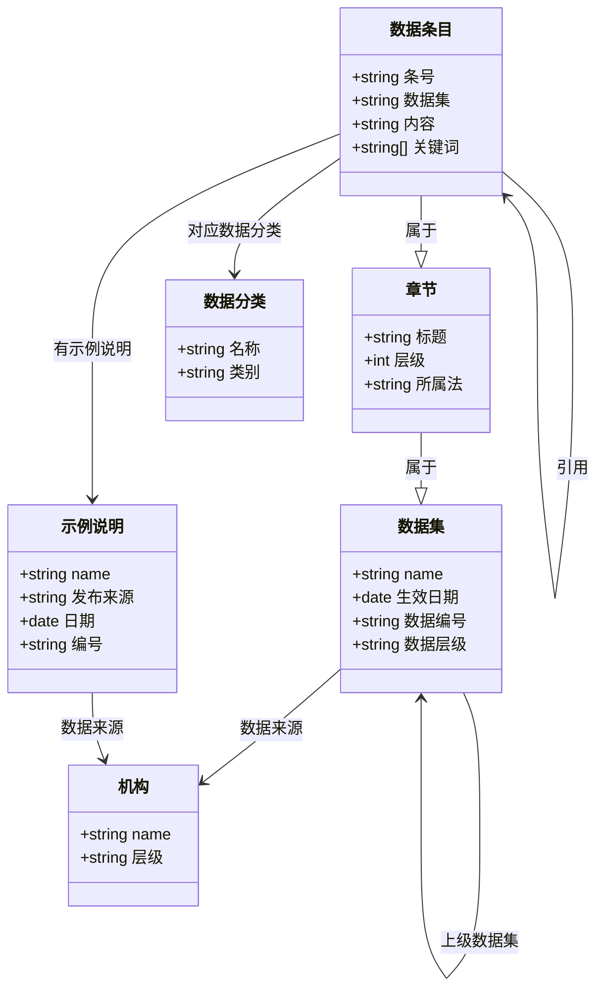
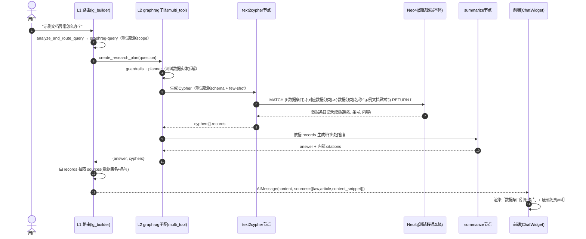
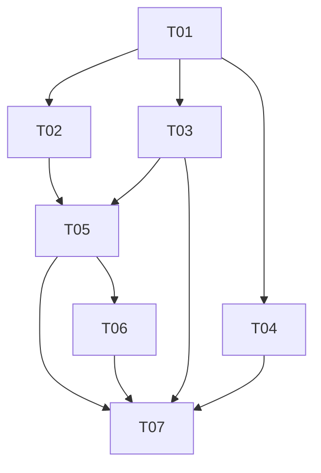

# My Agentix 测试数据集领域 · 架构设计与任务分解

> 文档性质：架构设计。在 **L1/L2/L3 三层编排骨架**之上，围绕「数据 / 配置 / 提示词 / 接线」四层给出测试数据集垂直领域的设计与任务分解。
> 适用范围：graphrag + kb 两路（Q-2）；text2sql 暂缓（Q-3）；本地演示（Q-4）；先构造示例数据验证链路（Q-1）。
> 设计原则：**复用现有技术栈、不引入新依赖、依赖方向单向**。

---

## 1. 实现方案 + 框架选型

### 1.1 核心难点与对策

| 难点 | 对策 |
|---|---|
| 图谱问答的链路唯一性 | 统一走主路径 `agentic_rag_agents`（LLM 动态 Cypher），不保留并行的规则式实现 |
| Neo4j 测试数据本体需重构并灌入种子数据 | 新增 `scripts/legal_kg_to_csv.py`，改 `Dockerfile` 的 `neo4j_seeded` 阶段灌库；动态 `graph.schema` 自动反映新本体 |
| text2cypher 需「懂测试数据」 | 新增自包含 `LegalCypherRetriever`，并改写 `kg_prompts.py` 中的 planner/guardrails/text2cypher 提示词 |
| 答复需可溯源（R-05） | graphrag 路径从 Neo4j 返回记录抽取「数据集名 + 条号」作为 `sources`；kb 路径沿用既有 `sources`；前端渲染引用卡片 |
| 免责声明（R-10） | 在 graphrag 小结提示词、kb `final_prompt`、kb 知识提示词、前端空态四处统一注入 |

### 1.2 框架 / 依赖选型

- **全部复用现有技术栈**：LangGraph（L1/L2/L3）、Neo4j（图谱）、Milvus（唯一向量后端，R3.7 起含结构化测试数据库）、LightRAG（社区摘要）、Vue3 + Vite（前端）。
- **无需新增第三方依赖**。新增的仅是「数据文件 + 转换器脚本 + 提示词 + 自包含 few-shot 检索器」，均为项目内模块。
- **OpenAI 兼容协议**（`settings.py`）不变，仅新增少量配置字段（如 `NEO4J_LEGAL_JSON_PATH`）。

---

## 2. 文件列表及相对路径（新增 / 修改，对应 R-01~R-13）

### 2.1 新增文件

| # | 相对路径 | 说明 | 对应需求 |
|---|---|---|---|
| N1 | `data/legal/legal_seed.json` | 测试数据本体种子数据（结构化 JSON：数据集/数据条目/章节/数据分类/示例说明/机构 + 关系），供 `legal_kg_to_csv.py` 转 CSV | R-01 |
| N2 | `data/legal/legal_lightrag_corpus.json` | 喂给 LightRAG 的测试数据原文语料（数据条目全文 + 示例说明全文），用于社区摘要索引 | R-04(LightRAG) |
| N3 | `data/kb/legal_corpus.txt` | 知识库（Milvus）测试文本语料（按数据条目/章节切块） | R-02 |
| N4 | `scripts/legal_kg_to_csv.py` | 把 `legal_seed.json` 转成 Neo4j-admin 兼容的节点/关系 CSV | R-01 |
| N5 | `agentix/application/agents/kg_sub_graph/agentic_rag_agents/retrievers/cypher_examples/legal_retriever.py` | `LegalCypherRetriever`：自包含测试数据 few-shot 示例，内含 `LEGAL_GRAPH_SCHEMA` 静态描述常量 | R-04 |
| N6 | `agentix/application/agents/kg_sub_graph/agentic_rag_agents/components/predefined_cypher/legal_cypher_dict.py` | 测试数据预定义 Cypher 字典（高频问法的固定 Cypher 模板） | R-04 |
| N7 | `docs/design/legal_domain_schema.md` | 测试数据本体 Neo4j schema 描述文本草案（喂 text2cypher 的静态说明）+ 溯源/免责声明共享约定 | R-04 / 共享知识 |

### 2.2 修改文件

| # | 相对路径 | 改动要点 | 对应需求 |
|---|---|---|---|
| M1 | `agentix/application/agents/lg_prompts.py` | 全量改写 `ROUTER_SYSTEM_PROMPT` / `GENERAL_QUERY_SYSTEM_PROMPT` / `GET_ADDITIONAL_SYSTEM_PROMPT` / `GUARDRAILS_SYSTEM_PROMPT` / `RAGSEARCH_SYSTEM_PROMPT` 等，统一为测试数据语境 | R-03 |
| M2 | `agentix/application/agents/kg_sub_graph/prompts/kg_prompts.py` | 改写 `GUARDRAILS/PLANNER/TEXT2CYPHER_GENERATION/TEXT2CYPHER_VALIDATION/TOOL_SELECTION/SUMMARIZE/FINAL_ANSWER` 为测试数据语境（被 graphrag 工作流的 guardrails/planner/tool-selection 节点实际引用） | R-04 / R-08 |
| M3 | agentix/application/agents/kg_sub_graph/agentic_rag_agents/components/summarize/prompts.py（A6 死代码批 2026-10-02 已删：全仓零引用，本行改写点失效） | 小结提示词改写以 M2（kg_prompts 的 SUMMARIZE 段）为准；原改动要点（「测试数据解读助手」+ 溯源/免责声明）并入 M2 落地 | R-05 / R-08 / R-10 |
| M4 | `agentix/application/agents/kg_sub_graph/agentic_rag_agents/components/text2cypher/generation/prompts.py` | 在 human 提示中追加静态 `LEGAL_GRAPH_SCHEMA` 描述（强化；动态 `graph.schema` 已自动反映本体，此为冗余保险） | R-04 |
| M5 | `agentix/application/agents/kb_tools/prompts.py` | `build_knowledge_system_prompt` 定义「测试数据助手」人设，要求附数据条目出处 | R-02 / R-05 |
| M6 | `agentix/application/agents/kg_sub_graph/agentic_rag_agents/workflows/multi_agent/multi_tool.py` | kb 子图 `scope_text` 默认与 `guardrails_prompt`/`router_prompt`/`final_prompt` 文案改测试数据；`final_prompt` 注入免责声明与溯源要求；空态文案改测试数据 | R-05 / R-08 / R-10 |
| M7 | `agentix/orchestration/langgraph/lg_builder.py` | 两处 `scope_description`（additional / graphrag）为测试数据语境；`_heuristic_router` 关键词为测试数据术语；引用 `LegalCypherRetriever`（line 21-22、840）；`get_additional_info` 兜底文案为测试数据语境；**新增**：从 graphrag 返回的 `cyphers[].records` 抽取 `sources` 并挂到 `AIMessage` | R-03 / R-04 / R-05 |
| M8 | `agentix/application/agents/kg_sub_graph/agentic_rag_agents/components/cypher_tools/node.py` | 三处引用 `LegalCypherRetriever`（line 8、79、105） | R-04 |
| M9 | `agentix/application/agents/kg_sub_graph/agentic_rag_agents/components/predefined_cypher/__init__.py`（或其导入点） | `predefined_cypher_dict` 改用 `legal_cypher_dict` | R-04 |
| M10 | `agentix/config/settings.py` | 新增 `NEO4J_LEGAL_JSON_PATH`、`LEGAL_LIGHTRAG_JSON_PATH`、`MILVUS_COLLECTION` 默认改 `legal`；`text2sql` 相关以注释标注「测试数据统计库暂缓」（R-11）；`KB_DATA_FILE` 默认指向 `legal_corpus.txt` | R-01 / R-02 / R-11 |
| M11 | `Dockerfile` | `neo4j_seeded` 阶段改用 `legal_kg_to_csv.py` + 测试数据 CSV；LightRAG build 阶段 `--json-path` 指向 `legal_lightrag_corpus.json` | R-01 / R-04(LightRAG) |
| M12 | `docker-compose.yml` | `MILVUS_COLLECTION=legal`、`KB_DATA_FILE=/app/data/kb/legal_corpus.txt`、`KB_EXCEL_PATH` 改测试数据表（可选）；`INIT_KB_MILVUS=true` 保留重建向量 | R-02 / R-11 |
| M13 | `agentix/application/agents/kg_sub_graph/agentic_rag_agents/components/text2sql/domain_knowledge.py` | 仅注释占位「测试数据统计库暂缓，本期不启用」（不改逻辑） | R-11 |
| M14 | `web/src/modules/chat/components/LandingPage.vue` | 主标题/副标题/示例问题 chips/数据源描述 | R-06 |
| M15 | `web/src/components/AgentChatWidget.vue` | 标题/占位符/quickSuggestions 改测试数据；**新增「数据条目引用卡片」组件**（数据集名/条号徽章/摘要折叠/来源）+ 免责声明空态 | R-07 / R-10 |
| M16 | `agentix/interfaces/http/v1/chat.py` | `/routes` 示例文案同步为测试数据示例 | R-03 一致性 |
| M17 | `data/kb/legal_corpus.txt` | 通过 M10/M12 将 `KB_DATA_FILE` 指向 N3 `legal_corpus.txt`（`data/kb/data.txt` 已不存在） | R-02 |

> 说明：R-09（kb 按数据条目/章节语义切块）通过把 `legal_corpus.txt` 以「一条数据条目一段」的形态组织 + 调整 `KB_CHUNK_SIZE` 实现，原则上不改动 `kb_ingest` 切块代码；若需更强粒度，作为后续增强（不在本期）。

---

## 3. 数据结构 / 接口

> ⚠️ 本节（含 3.1 类图与 3.2 schema 草案）的名称按「测试数据集」口径书写。Neo4j 图谱中**真实的节点 Label、关系类型、属性名与查询参数名**是功能性标识符，不随文案泛化；编写 Cypher 必须以真源为准：[legal_domain_schema.md](legal_domain_schema.md) 与 `LegalCypherRetriever.LEGAL_GRAPH_SCHEMA`（[legal_retriever.py:34](../../agentix/application/agents/kg_sub_graph/agentic_rag_agents/retrievers/cypher_examples/legal_retriever.py)）。

### 3.1 测试数据集本体类图（Mermaid classDiagram）

> 同时见 `docs/design/class-diagram.mermaid`。



**节点属性（建议）**
- `数据集`：`name`、`生效日期`、`数据编号`、`数据层级`（测试数据/类别三规范/数据规范…）
- `数据条目`：`条号`、`数据集`、`内容`、`关键词[]`
- `章节`：`标题`、`层级`、`所属法`
- `数据分类`：`名称`、`类别`（类别二/类别一/类别三）
- `示例说明`：`name`、`发布来源`、`日期`、`编号`
- `机构`：`name`、`层级`

**关系（类型 + 方向）**
- `属于`：数据条目 → 章节 → 数据集
- `引用`：数据条目 → 数据条目
- `对应数据分类`：数据条目 → 数据分类
- `有示例说明`：数据条目/数据集 → 示例说明
- `数据来源`：数据集/示例说明 → 机构
- `上级数据集`：下级数据集 → 上级数据集（数据集 → 数据集）

### 3.2 喂给 text2cypher 的 Neo4j schema 描述文本草案

> 该文本作为 `LegalCypherRetriever.LEGAL_GRAPH_SCHEMA` 常量，并写入 `docs/design/legal_domain_schema.md`。注意：激活态的 `text2cypher` 生成提示（`text2cypher/generation/prompts.py`）已用动态 `graph.schema`，本静态文本为强化与可读性补充；一旦测试数据本体灌入 Neo4j，动态 schema 自动生效。

```text
你正在查询一个中国测试数据知识图谱（Neo4j）。图谱结构如下：

【节点 Label 与属性】
- 数据集(Regulation): name(数据集名), 生效日期, 数据编号, 数据层级
- 数据条目(Article): 条号, 数据集(所属数据集名), 内容, 关键词
- 章节(Chapter): 标题, 层级, 所属法
- 数据分类(Cause): 名称, 类别(类别二/类别一/类别三)
- 示例说明(JudicialInterpretation): name, 发布来源, 日期, 编号
- 机构(Authority): name, 层级

【关系类型与方向】
- (数据条目)-[:属于]->(章节)
- (章节)-[:属于]->(数据集)
- (数据条目)-[:引用]->(数据条目)            // 数据条目互引
- (数据条目)-[:对应数据分类]->(数据分类)        // 数据条目适用的问题类型
- (数据条目)-[:有示例说明]->(示例说明)  // 本条文对应的示例说明
- (数据集)-[:数据来源]->(机构)
- (示例说明)-[:数据来源]->(机构)
- (数据集)-[:上级数据集]->(数据集)          // 下级数据集指向上级数据集

【生成规则】
1. 仅输出 Cypher，禁止反引号/解释。
2. 用 MATCH/WITH 开头；标签、关系、属性名必须与上面完全一致。
3. 过滤用参数化（$数据集名/$条号/$数据分类名），不要硬编码。
4. 排序数据条目按条号数值；多结果用 LIMIT。
5. 返回时尽量带上 数据集名 与 条号 以便溯源。
```

### 3.3 溯源（sources）数据结构约定

跨路径统一 `sources` 为 `list[dict]`：

```python
{
  "type": "graphrag" | "kb",      # 来源路径
  "law": "示例数据集 A",                 # 数据集名（graphrag 必填）
  "article": "第577条",            # 条号（graphrag 必填）
  "content_snippet": "参与方一方不履行…",  # 条文摘要（可选）
  "source": "《示例数据集 A》第577条",   # 展示用来源标记（R-05/R-07）
  "document_id": "..."             # kb 路径沿用既有 document_id
}
```

`lg_builder.create_research_plan` 需从 graphrag 返回的 `response["cyphers"][*].records` 中按「数据集名 + 条号」抽取并组装上述 `sources`，附加到 `AIMessage.additional_kwargs["sources"]`；`chat.py` 已支持读取 `result.get("sources")`，前端据此渲染引用卡片。

---

## 4. 程序调用流程（时序图）

> 场景：用户问「示例文档异常怎么办？」→ 命中 graphrag → text2cypher → Neo4j → summarize → 带出处答复。同时见 `docs/design/sequence-diagram.mermaid`。



> kb 路径（R-02）：`create_kb_query` → `create_kb_multi_tool_workflow` → kb_ingest 结构化库（Milvus legal）优先 / milvus 兜底 → `final_prompt` 合成含溯源与免责声明的答复，`sources` 原样透传。

---

## 5. 任务列表（有序、含依赖、按实现顺序）

> 顺序按 ①~⑦ 展开；T 编号即实现顺序。括号内为对应需求。

| 任务 | 名称 | 依赖 | 涉及文件（关键） | 优先级 |
|---|---|---|---|---|
| **T01** | 测试数据本体 + Neo4j 种子数据 | 无 | N1 `legal_seed.json`、N4 `legal_kg_to_csv.py`、M11 `Dockerfile`、M10 `settings.py`（新增字段） | P0 |
| **T02** | 测试数据 text2cypher 示例 / 校验 | T01 | N5 `legal_retriever.py`、N6 `legal_cypher_dict.py`、M2 `kg_prompts.py`(text2cypher)、M4、M8、M9、N7 `schema` 文档 | P0 |
| **T03** | kb 语料替换 + 向量索引重建 | T01 | N3 `legal_corpus.txt`、M5 `kb_tools/prompts.py`、M10/M12 `settings`+`compose`、`kb_ingest`(重建) | P0 |
| **T04** | LightRAG 测试数据索引重建 | T01 | N2 `legal_lightrag_corpus.json`、M11 `Dockerfile`(LightRAG build) | P1 |
| **T05** | L1/L2 提示词 + 免责声明 | T01,T02,T03 | M1 `lg_prompts.py`、M2 `kg_prompts.py`、M3 summarize/prompts.py（A6 已删，见 M 表注）、M6 `multi_tool.py`、M7 `lg_builder.py`、M13(Milvus/R-11注释)、M16 `chat.py` | P0/P1 |
| **T06** | 前端文案 + 数据条目引用卡片 | T05 | M14 `LandingPage.vue`、M15 `ChatWidget.vue` | P1 |
| **T07** | 联调验证（路由/溯源/免责） | T05,T06（及 T03/T04） | 端到端 `docker compose` 验证；`tests/` 补 graphrag 溯源与 kb 回归 | P0 |

**依赖关系图（Mermaid）**



---

## 6. 依赖包列表

**无新增第三方依赖。** 全部复用现有 `requirements.txt` 中的 LangGraph / langchain-neo4j / neo4j / lightrag / fastapi / vue3 等。本期预计依赖包清单为空或极少（仅可能微调 `pyproject`/环境注释，无新库）。

---

## 7. 共享知识（跨文件约定）

1. **领域 schema 文本统一存放**
   - 权威动态 schema 来自 Neo4j `graph.schema`（灌库后自动生效）。
   - 静态补充文本放 `legal_retriever.py` 的 `LEGAL_GRAPH_SCHEMA` 常量，并在 `docs/design/legal_domain_schema.md` 留档；`kg_prompts.TEXT2CYPHER_GENERATION_PROMPT` 与 `text2cypher/generation/prompts.py` 引用同一份描述，避免漂移。
2. **few-shot 示例组织方式**
   - `LegalCypherRetriever` 内部按「问题类型」字典组织示例（自包含），字典键对齐测试数据实体：如 `article_by_cause`（数据分类查数据条目）、`article_by_law`（数据集+条号查引用）、`interpretation_by_cause`（数据分类查示例说明）、`authority_docs`（机构查规定）、`upper_law`（上级数据集）等。
   - 检索器为自包含实现，不依赖外部规则式分类器。
3. **溯源格式约定**
   - 见 3.3 节 `sources` 结构。`graphrag` 路径在 `lg_builder.create_research_plan` 由 `cyphers[].records` 抽取；`kb` 路径沿用 `kb_ingest` 与检索域 usecases 既有 `sources`（document_id/source；旧 `knowledge_service` 已归档）。前端统一消费 `sources` 渲染引用卡片。
4. **免责声明文案常量**
   - 统一文案：「本回答由 AI 基于公开测试文本生成，不构成正式测试结论，具体以官方发布文本及专业专业人员意见为准。」
   - 出现位置：graphrag `summarize` 提示词、kb `multi_tool.final_prompt`、kb 知识提示词、`ChatWidget` 空态；以常量集中管理（建议放 `lg_prompts.py` 或新建 `shared_constants.py`），避免四处硬编码。
5. **配置开关约定**
   - 域切换通过「数据 + 提示词」完成，不引入运行时 domain flag；如需灰度，用环境变量（`NEO4J_LEGAL_JSON_PATH` 等）占位，主路径仍以 Docker 构建期灌库为准。

---

## 8. 待明确事项（⚠️）

1. **示例数据规模/真实度**：Q-1 已定「先构造示例数据」。建议最小集：《示例数据集 A》《示例数据集 B》部分数据条目 + 3~5 个数据分类（示例文档异常/盗窃/正当防卫/离婚财产分割/用工文档解除）+ 2~3 个示例说明 + 若干机构（最高法/最高检/市场监管总局）。是否需覆盖到「章节」层级请确认。
2. **溯源在 graphrag 路径的实现强度**：R-05 要求「无来源不允许返回」。本期方案是在 `lg_builder` 由 records 抽取 `sources` 并强制前端展示；是否还要在 `summarize` 阶段把 `[1]` 角标嵌入正文，请确认（建议做，提升可信度）。
3. **LightRAG 语料与图谱是否同源**：建议 LightRAG 用「数据条目全文 + 示例说明全文」文本，图谱用结构化本体，二者可同源于 `legal_seed.json` 的不同视图。
4. **text2sql 占位形式**：R-11 仅占位。本期在 `settings.py`（注释「测试数据统计库暂缓」）+ `domain_knowledge.py`（注释）标注，不实现接口调用；`route_query` 仍保留 `text2sql-query` 分支但前端不引导。
5. **image/file 路由**：R-12 暂缓，本期不改其测试数据适配，仅保证不命中测试数据范围时走现有兜底/拒绝。
7. **免责声明强度（Q-4 本地演示）**：按「非测试结论」轻量处理，未做强制鉴权；若后续转生产需补充实名/免责弹窗/日志审计（超出本期）。

---

## 9. 明确「哪些文件绝对不要动」（架构不变项清单）

以下为**编排骨架**，本期**严禁改动**（仅可加注释/新增并行文件）：

1. **`lg_builder.py` 的图结构**：`StateGraph` 节点定义、`route_query` 分支、`allowed_types` 集合、各 `add_node/add_edge` —— 不改骨架；仅改两处 `scope_description` 字符串与 `import` 目标、关键词。
2. **`multi_tool.py` 的 `create_multi_tool_workflow` / `create_kb_multi_tool_workflow` 图结构**：节点与边不动；仅改内部 `scope_text` 默认文案与 `final_prompt` 字符串（及可选 sources 输出）。
3. **L3 原子工具**：`kg_neo4j_conn.get_neo4j_graph`、`application/services/lightrag_service.py`（旧 `knowledge_service.py` 已归档）、`kb_ingest/kb_service/services/vector_store.py` —— 不改。
4. **`kb_ingest/` 的 FastAPI 服务与 ingest 流程**：机制不动，仅换输入语料（`legal_corpus.txt`）。
5. **`ps_genai_agents/` 平行变体**：主路径用 `agentic_rag_agents`，此变体不动。
6. **`settings.py` 结构 / OpenAI 兼容协议配置**：不改结构，仅增字段。
7. **Web 技术栈（Vue3 + Vite）与极薄原则**：不改。
8. **`text2cypher/generation/prompts.py` 模板结构**：保留模板，仅注入 `LEGAL_GRAPH_SCHEMA` 文本常量，不影响结构。

---

## 附：领域要素一览

| 项 | 实现 |
|---|---|
| 领域语义（提示词 / 兜底文案 / 示例问题 / 前端文案） | 测试数据集语境 |
| Cypher 检索器 | `LegalCypherRetriever`（自包含测试数据 few-shot） |
| 预定义 Cypher 字典 | `legal_cypher_dict.py` |
| Neo4j 测试数据本体 | `scripts/legal_kg_to_csv.py` + `data/legal/legal_seed.json` |
| LightRAG 语料 | `data/legal/legal_lightrag_corpus.json` |
| 知识库语料 | `data/kb/legal_corpus.txt` |
| 向量库字段 / 知识库服务方法 | 测试数据域命名（`doc_id` / `title` / `article_no`） |
| 前端 | 测试数据文案 + 数据条目引用卡片 + 免责声明 |

---

> 设计结论一句话：测试数据集领域落在**数据 / 配置 / 提示词 / 接线**四层；Neo4j 用 `legal_kg_to_csv.py` 构建测试数据本体，text2cypher 用自包含 `LegalCypherRetriever`，kb / LightRAG 使用测试数据语料；L1/L2/L3 编排骨架保持不变。

---

## 附二：编排替代性论证（指针）

本文只描述编排拓扑，未回答「为何这些环节不能用确定性 Workflow 替代」。
逐环节论证见 **[`docs/design/orchestration-rationale.md`](./orchestration-rationale.md)**：
自主环节清点（§1）、逐个四问论证（§2）、应为 Workflow 的反向论证（§3）、判据表（§4）、与 40 条清单对应（§5）。
该文件对应《My Agentix_架构优化方案.md》§9.1-A「任务分解与规划」第 6 条，新增自主节点时须同步补齐。
