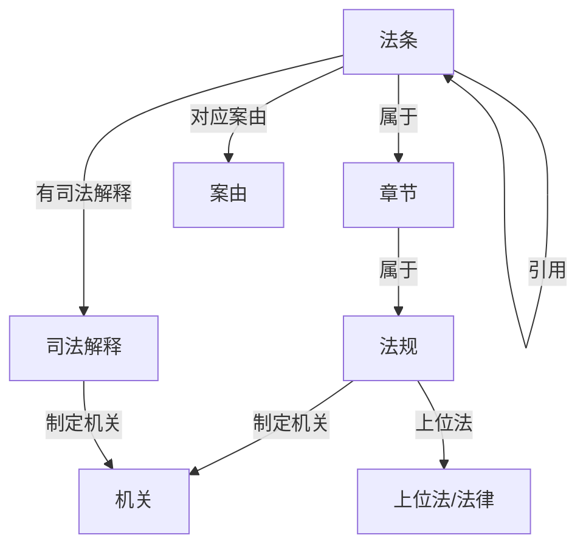

# My Agentix 法律法规领域 · 产品需求文档（PRD）

> **文档性质**：产品需求文档（PRD）。本文**不重写已有架构**，只描述法律法规/法条领域在现有 LangGraph 三层架构之上的**领域需求**。
> **适用范围**：My Agentix 现有 LangGraph 三层 Multi-Agent 架构（L1 主路由 → L2 多工具子图 → L3 原子工具）保持不变，仅做领域适配。
> **标注约定**：凡标注「⚠️ 待确认」者为推荐默认假设，**未定死**，需确认。

---

## 0. 领域要素总览（一句话定位）

| 项 | 法律法规领域 |
|---|---|
| 核心对象 | 法规 / 法条 / 章节 / 案由 / 司法解释 / 机关 |
| 图谱（Neo4j） | 法律本体图谱 |
| 向量语料（Milvus） | 法条、司法解释文本 |
| 入口路由 | 法律咨询意图分类 |
| 前端文案 | 法律咨询助手 + 法条引用卡片 |

---

## 1. 产品目标（一句话）

本 PRD 定义 My Agentix 的**法律领域参考实现**：面向中国法律法规/法条领域，让用户以自然语言获得**可溯源、带法条出处**的法律咨询答复。（项目整体定位见根目录 README——以 Agent 内核 + RAG 等多路检索为核心的综合服务平台，法律仅为参考领域之一。）

---

## 2. 用户故事（法律咨询场景）

| # | 角色 | 故事 | 价值 |
|---|---|---|---|
| US-1 | 普通公民 | 作为普通公民，我想问「租房合同违约怎么办」，以便快速了解相关法律条文与救济途径，而不必通读民法典。 | 降低法律信息获取门槛 |
| US-2 | 律师 / 法务 | 作为法律从业者，我想查询某法条的司法解释与互引法条，以便撰写文书时快速定位依据。 | 提升检索效率，避免遗漏引用 |
| US-3 | 法考生 | 作为法考生，我想通过案由反查涉及的法条与所属章节，以便系统性复习。 | 以「问题/案由」驱动学习 |
| US-4 | 小企业主 | 作为小企业主，我想了解某机关（如市场监管总局）制定的规定有哪些，以便合规经营。 | 合规自查 |
| US-5 | 所有用户 | 作为产品用户，我希望每条答复都标注法条出处（引用卡片），以便核实真实性、避免被幻觉误导。 | 可信、可追溯（P0 体验底线） |

---

## 3. 需求池（领域需求清单）

> 优先级定义：P0 = 必须（阻塞演示/上线）；P1 = 应该（首版体验）；P2 = 可选（后续增强）。

### P0 — 领域核心切换（阻塞项）

| ID | 需求 | 说明 / 验收标准 |
|---|---|---|
| R-01 | **Neo4j 法律本体构建** | 建立法律本体（见第 4 节）。提供图谱初始化脚本 `scripts/` 与一批**示例法律数据**（图谱 + 语料）。验收：示例数据可入库，text2cypher 可查询。 |
| R-02 | **知识库语料替换** | `kb_ingest/` 导入法律法规文本（条文、司法解释）。重建 Milvus 索引。验收：导入流程跑通，RAG 检索返回法条片段。 |
| R-03 | **L1 路由意图语料/提示词更新** | `lg_builder.py` 的意图分类 prompt 与示例，采用「法律咨询」语义，确保 general / additional / graphrag / kb 四类命中正确（image/file/text2sql 暂保留但降权）。验收：路由准确率在示例集上 ≥ 预期基线。 |
| R-04 | **法律实体抽取 & text2cypher 提示词重写** | 重写 LightRAG 社区检索与 Neo4j 查询的提示词为法律领域（实体：法规/法条/案由…；关系：属于/引用/上位法…）。验收：给定自然语言可生成合法 Cypher。 |
| R-05 | **答复可溯源（法条出处）** | 所有经 graphrag/kb 返回的答复必须附带来源标记（法规名 + 条号 / 文档来源）。验收：无来源的法条类答复不允许直接返回给用户。 |

### P1 — 首版体验

| ID | 需求 | 说明 |
|---|---|---|
| R-06 | **前端 LandingPage 文案** | 标题/副标题/示例问题 chips 改为法律场景（见第 5 节）。 |
| R-07 | **聊天「法条引用卡片」组件** | 回复气泡下方展示法规名、条号徽章、条文摘要（可折叠）、来源标记；hover/点击展开全文。 |
| R-08 | **graphrag 子图法律调优** | `multi_tool.py` 中 `create_multi_tool_workflow` 的社区摘要语言、检索 prompt 改为法律领域表达。 |
| R-09 | **kb 子图法律语料分块策略** | `create_kb_multi_tool_workflow` 按「法条/章节」语义切块，提升检索粒度。 |
| R-10 | **法律免责声明** | 无结果/边界场景下明确提示「本回答不构成正式法律意见，请以官方文本为准」。 |

### P2 — 后续增强（暂缓）

| ID | 需求 | 说明 |
|---|---|---|
| R-11 | **text2sql 预留占位** | 在 `settings.py` 以注释标注「法律统计库暂缓」，保留接口与配置项但不启用。 |
| R-12 | **image/file 路由法律适配** | 未来支持合同图片 OCR → 法条检索，本期不实现。 |
| R-13 | **简繁 / 多语言支持** | 未来增强，非首版需求。 |

---

## 4. 法律法规领域本体映射

### 4.1 节点（Label）

| 节点 | 含义 | 关键属性示例 |
|---|---|---|
| `:法规` | 一部法律/法规（如《民法典》《刑法》） | name, 生效日期, 发文字号 |
| `:法条` | 具体条文 | 条号, 内容, 关键词 |
| `:章节` | 编/章/节 | 标题, 层级 |
| `:案由` | 案件事由/纠纷类型 | 名称（如"合同违约"） |
| `:司法解释` | 两高司法解释/批复 | 名称, 发布机关, 日期 |
| `:机关` | 制定/发布机关 | 名称（如"最高人民法院"） |

### 4.2 关系（Relationship）

| 关系 | 方向/语义 | 示例 |
|---|---|---|
| `属于` | 法条 → 章节 → 法规 的归属 | (法条)-[:属于]->(章节) |
| `引用` | 法条互引（法条 → 法条） | (法条A)-[:引用]->(法条B) |
| `对应案由` | 法条 → 案由 | (法条)-[:对应案由]->(案由) |
| `有司法解释` | 法条/法规 → 司法解释 | (法条)-[:有司法解释]->(司法解释) |
| `制定机关` | 法规/司法解释 → 机关 | (法规)-[:制定机关]->(机关) |
| `上位法` | 下位法 → 上位法 | (行政法规)-[:上位法]->(法律) |

### 4.3 本体示意图（Mermaid）



### 4.4 text2cypher 自然语言问法示例（5 个）

> 以下自然语言 → 期望 Cypher，用于校验 R-04 的提示词效果。

1. **「合同违约相关法条有哪些」**
   ```cypher
   MATCH (f:法条)-[:对应案由]->(:案由 {名称:"合同违约"}) RETURN f
   ```
2. **「民法典第 577 条引用了哪些法条」**
   ```cypher
   MATCH (f:法条 {条号:"577", 法规:"民法典"})-[:引用]->(t:法条) RETURN t
   ```
3. **「刑法关于盗窃的司法解释有哪些」**
   ```cypher
   MATCH (f:法条)-[:对应案由]->(:案由 {名称:"盗窃"})
   MATCH (f)<-[:有司法解释]-(e:司法解释) RETURN e
   ```
4. **「最高人民法院发布了哪些与正当防卫相关的规定」**
   ```cypher
   MATCH (o:机关 {名称:"最高人民法院"})-[:制定机关]-(doc)
   WHERE doc 涉及 "正当防卫" RETURN doc
   ```
5. **「劳动合同法的上位法是什么」**
   ```cypher
   MATCH (f:法规 {名称:"劳动合同法"})-[:上位法]->(p) RETURN p
   ```

---

## 5. UI 设计稿（文字描述）

### 5.1 LandingPage（文案）

- **主标题**：「你的法律咨询智能助手」/ 副标题「覆盖《民法典》《刑法》及司法解释，问答可溯源」
- **示例问题 chips**：
  - 「租房违约怎么赔？」
  - 「离婚财产分割依据？」
  - 「正当防卫的边界？」
  - 「劳动合同解除条件？」
- 保留极薄结构（Vue3 + Vite），仅改静态文案与示例数据，不引入新框架。

### 5.2 ChatWidget（交互增强）

- **保留**：极薄聊天容器、输入框、气泡布局不变。
- **新增「法条引用卡片」**（P1 / R-07）：
  - 位置：AI 回复气泡下方。
  - 内容：① 法规名称（粗体）② 条号徽章（如「第 577 条」）③ 条文摘要（默认折叠，点击展开全文）④ 来源标记（「来源：《民法典》 第 577 条」）。
  - 交互：hover 高亮、点击展开；多个出处以卡片列表呈现。
- **可选轻标签**（非必须）：输入区上方增加「民事 / 刑事 / 行政」咨询类型标签，用于辅助路由（R-03）命中。
- **免责声明态**（R-10）：当命中无结果或边界场景，气泡底部固定提示「本回答不构成正式法律意见，请以官方文本为准」。

### 5.3 错误/空态

- 图谱与向量库均无命中时，返回「暂未检索到相关法条，建议咨询专业律师」，不编造条文。

---

## 6. 待确认问题（⚠️ 待确认）

> 以下为推荐默认假设，**需确认后定稿**，PRD 不擅自定死。

| # | 待确认项 | 推荐默认假设 | 影响 |
|---|---|---|---|
| Q-1 | **法律数据来源** | 先**构造一批示例法律数据**（图谱 + 语料），验证链路后再补真实数据 | 决定 R-01/R-02 工作量与数据管线 |
| Q-2 | **实现范围** | **graphrag + kb 两路**先落地，暂缓 text2sql | 决定本期实现边界（见 R-11） |
| Q-3 | **是否要 text2sql 及数据可得性** | **暂缓**（法律统计库最难获取，数据可得性低） | 影响 MySQL 查询链路是否本期动 |
| Q-4 | **部署目标** | ⚠️ 待确认：本地演示 / 生产 | 影响鉴权、合规、免责声明强度（R-10）、数据安全要求 |

---

## 附：与原有架构的不变项（明确排除，避免重写）

- L1/L2/L3 三层结构与各文件（lg_builder.py / multi_tool.py / chat.py / settings.py）**不改架构**，仅改领域内容与提示词。
- kb_ingest 独立 FastAPI 导入机制不变，仅换导入内容。
- web 前端技术栈（Vue3+Vite）与极薄原则不变。
- 全 OpenAI 兼容协议配置（`settings.py`）不变。
