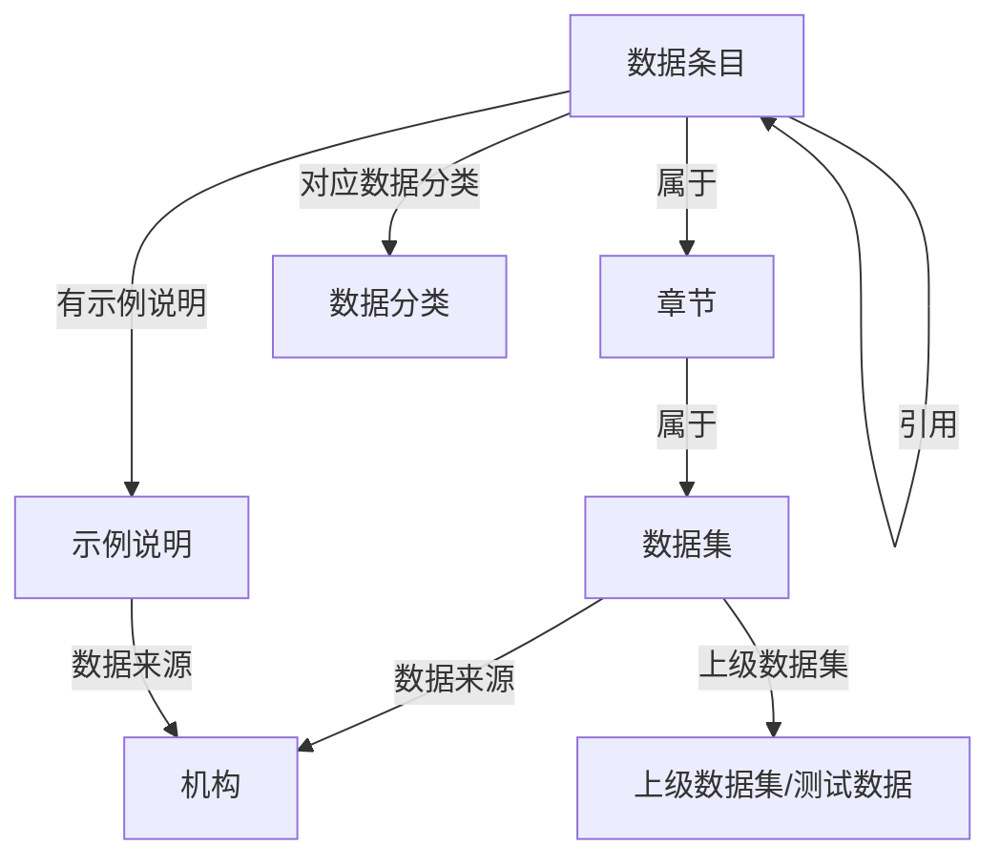

# My Agentix 测试数据集领域 · 产品需求文档（PRD）

> **文档状态**：现行专题文档 · 与代码同步维护。
> 文档分层：唯一现行总览是根 [README](../../README.md)，实现细节见 [PROJECT_SPEC](../项目实现手册.md)，本文只讲本专题。

> **文档性质**：产品需求文档（PRD）。本文**不重写已有架构**，只描述测试数据集/数据条目领域在现有 LangGraph 单层主图之上的**领域需求**。
> **适用范围**：My Agentix 现有 LangGraph **单层主图 + 节点内子图**架构（一张 `StateGraph` 平铺节点、条件边路由；`graphrag` / `kb` 两节点内部再嵌子图）保持不变，仅做领域适配。
> **标注约定**：凡标注「⚠️ 待确认」者为推荐默认假设，**未定死**，需确认。

---

## 0. 领域要素总览（一句话定位）

| 项 | 测试数据集领域 |
|---|---|
| 核心对象 | 数据集 / 数据条目 / 章节 / 数据分类 / 示例说明 / 机构 |
| 图谱（Neo4j） | 测试数据本体图谱 |
| 向量语料（Milvus） | 数据条目、示例说明文本 |
| 入口路由 | 数据问答意图分类 |
| 前端文案 | 数据问答助手 + 数据条目引用卡片 |

---

## 1. 产品目标（一句话）

本 PRD 定义 My Agentix 的**测试数据领域参考实现**：面向中国测试数据集/数据条目领域，让用户以自然语言获得**可溯源、带数据条目出处**的数据问答答复。（项目整体定位见根目录 README——以 Agent 内核 + RAG 等多路检索为核心的综合服务平台，测试数据仅为参考领域之一。）

---

## 2. 用户故事（数据问答场景）

| # | 角色 | 故事 | 价值 |
|---|---|---|---|
| US-1 | 普通公民 | 作为普通公民，我想问「示例文档异常怎么办」，以便快速了解相关数据条目与救济途径，而不必通读示例数据集 A。 | 降低数据信息获取门槛 |
| US-2 | 专业人员 / 数据事务 | 作为测试数据从业者，我想查询某数据条目的示例说明与互引数据条目，以便撰写文档时快速定位依据。 | 提升检索效率，避免遗漏引用 |
| US-3 | 法考生 | 作为法考生，我想通过数据分类反查涉及的数据条目与所属章节，以便系统性复习。 | 以「问题/数据分类」驱动学习 |
| US-4 | 小企业主 | 作为小企业主，我想了解某机构（如市场监管总局）制定的规定有哪些，以便规范经营。 | 规范自查 |
| US-5 | 所有用户 | 作为产品用户，我希望每条答复都标注数据条目出处（引用卡片），以便核实真实性、避免被幻觉误导。 | 可信、可追溯（P0 体验底线） |

---

## 3. 需求池（领域需求清单）

> 优先级定义：P0 = 必须（阻塞演示/上线）；P1 = 应该（首版体验）；P2 = 可选（后续增强）。

### P0 — 领域核心切换（阻塞项）

| ID | 需求 | 说明 / 验收标准 |
|---|---|---|
| R-01 | **Neo4j 测试数据本体构建** | 建立测试数据本体（见第 4 节）。提供图谱初始化脚本 `scripts/` 与一批**示例测试数据**（图谱 + 语料）。验收：示例数据可入库，text2cypher 可查询。 |
| R-02 | **知识库语料替换** | `kb_ingest/` 导入测试数据集文本（条文、示例说明）。重建 Milvus 索引。验收：导入流程跑通，RAG 检索返回数据条目片段。 |
| R-03 | **L1 路由意图语料/提示词更新** | `lg_builder.py` 的意图分类 prompt 与示例，采用「数据问答」语义，确保 general / additional / graphrag / kb 四类命中正确（image/file/text2sql 暂保留但降权）。验收：路由准确率在示例集上 ≥ 预期基线。 |
| R-04 | **测试数据实体抽取 & text2cypher 提示词重写** | 重写 LightRAG 社区检索与 Neo4j 查询的提示词为测试数据领域（实体：数据集/数据条目/数据分类…；关系：属于/引用/上级数据集…）。验收：给定自然语言可生成合法 Cypher。 |
| R-05 | **答复可溯源（数据条目出处）** | 所有经 graphrag/kb 返回的答复必须附带来源标记（数据集名 + 条号 / 文档来源）。验收：无来源的数据条目类答复不允许直接返回给用户。 |

### P1 — 首版体验

| ID | 需求 | 说明 |
|---|---|---|
| R-06 | **前端 LandingPage 文案** | 标题/副标题/示例问题 chips 改为测试数据场景（见第 5 节）。 |
| R-07 | **聊天「数据条目引用卡片」组件** | 回复气泡下方展示数据集名、条号徽章、条文摘要（可折叠）、来源标记；hover/点击展开全文。 |
| R-08 | **graphrag 子图测试数据调优** | `multi_tool.py` 中 `create_multi_tool_workflow` 的社区摘要语言、检索 prompt 改为测试数据领域表达。 |
| R-09 | **kb 子图测试数据语料分块策略** | `create_kb_multi_tool_workflow` 按「数据条目/章节」语义切块，提升检索粒度。 |
| R-10 | **测试数据免责声明** | 无结果/边界场景下明确提示「本回答不构成正式测试结论，请以官方文本为准」。 |

### P2 — 后续增强（暂缓）

| ID | 需求 | 说明 |
|---|---|---|
| R-11 | **text2sql 预留占位** | 在 `settings.py` 以注释标注「测试数据统计库暂缓」，保留接口与配置项但不启用。 |
| R-12 | **image/file 路由测试数据适配** | 未来支持示例文档图片 OCR → 数据条目检索，本期不实现。 |
| R-13 | **简繁 / 多语言支持** | 未来增强，非首版需求。 |

---

## 4. 测试数据集领域本体映射

> ⚠️ 下表 Label、关系类型与 4.4 的 Cypher 示例按「测试数据集」口径书写。图谱中**真实的功能性标识符**（节点 Label、关系类型、属性名）未随文案泛化，落库与查询以真源为准：[测试数据域-本体Schema.md](测试数据域-本体Schema.md) 与 `LegalCypherRetriever.LEGAL_GRAPH_SCHEMA`（[legal_retriever.py:34](../../agentix/application/agents/kg_sub_graph/agentic_rag_agents/retrievers/cypher_examples/legal_retriever.py)）。

### 4.1 节点（Label）

| 节点 | 含义 | 关键属性示例 |
|---|---|---|
| `:数据集` | 一部测试数据/数据集（如《示例数据集 A》《示例数据集 B》） | name, 生效日期, 数据编号 |
| `:数据条目` | 具体条文 | 条号, 内容, 关键词 |
| `:章节` | 编/章/节 | 标题, 层级 |
| `:数据分类` | 案件事由/问题类型 | 名称（如"示例文档异常"） |
| `:示例说明` | 两高示例说明/批复 | 名称, 发布来源, 日期 |
| `:机构` | 制定/发布来源 | 名称（如"最高处理机构"） |

### 4.2 关系（Relationship）

| 关系 | 方向/语义 | 示例 |
|---|---|---|
| `属于` | 数据条目 → 章节 → 数据集 的归属 | (数据条目)-[:属于]->(章节) |
| `引用` | 数据条目互引（数据条目 → 数据条目） | (数据条目A)-[:引用]->(数据条目B) |
| `对应数据分类` | 数据条目 → 数据分类 | (数据条目)-[:对应数据分类]->(数据分类) |
| `有示例说明` | 数据条目/数据集 → 示例说明 | (数据条目)-[:有示例说明]->(示例说明) |
| `数据来源` | 数据集/示例说明 → 机构 | (数据集)-[:数据来源]->(机构) |
| `上级数据集` | 下级数据集 → 上级数据集 | (类别三规范)-[:上级数据集]->(测试数据) |

### 4.3 本体示意图（Mermaid）



### 4.4 text2cypher 自然语言问法示例（5 个）

> 以下自然语言 → 期望 Cypher，用于校验 R-04 的提示词效果。

1. **「示例文档异常相关数据条目有哪些」**
   ```cypher
   MATCH (f:数据条目)-[:对应数据分类]->(:数据分类 {名称:"示例文档异常"}) RETURN f
   ```
2. **「示例数据集 A 第 577 条引用了哪些数据条目」**
   ```cypher
   MATCH (f:数据条目 {条号:"577", 数据集:"示例数据集 A"})-[:引用]->(t:数据条目) RETURN t
   ```
3. **「示例数据集 B关于盗窃的示例说明有哪些」**
   ```cypher
   MATCH (f:数据条目)-[:对应数据分类]->(:数据分类 {名称:"盗窃"})
   MATCH (f)<-[:有示例说明]-(e:示例说明) RETURN e
   ```
4. **「最高处理机构发布了哪些与正当防卫相关的规定」**
   ```cypher
   MATCH (o:机构 {名称:"最高处理机构"})-[:数据来源]-(doc)
   WHERE doc 涉及 "正当防卫" RETURN doc
   ```
5. **「用工文档法的上级数据集是什么」**
   ```cypher
   MATCH (f:数据集 {名称:"用工文档法"})-[:上级数据集]->(p) RETURN p
   ```

---

## 5. UI 设计稿（文字描述）

### 5.1 LandingPage（文案）

- **主标题**：「你的数据问答智能助手」/ 副标题「覆盖《示例数据集 A》《示例数据集 B》及示例说明，问答可溯源」
- **示例问题 chips**：
  - 「租房异常怎么赔？」
  - 「离婚财产分割依据？」
  - 「正当防卫的边界？」
  - 「用工文档解除条件？」
- 保留极薄结构（Vue3 + Vite），仅改静态文案与示例数据，不引入新框架。

### 5.2 ChatWidget（交互增强）

- **保留**：极薄聊天容器、输入框、气泡布局不变。
- **新增「数据条目引用卡片」**（P1 / R-07）：
  - 位置：AI 回复气泡下方。
  - 内容：① 数据集名称（粗体）② 条号徽章（如「第 577 条」）③ 条文摘要（默认折叠，点击展开全文）④ 来源标记（「来源：《示例数据集 A》 第 577 条」）。
  - 交互：hover 高亮、点击展开；多个出处以卡片列表呈现。
- **可选轻标签**（非必须）：输入区上方增加「类别二 / 类别一 / 类别三」咨询类型标签，用于辅助路由（R-03）命中。
- **免责声明态**（R-10）：当命中无结果或边界场景，气泡底部固定提示「本回答不构成正式测试结论，请以官方文本为准」。

### 5.3 错误/空态

- 图谱与向量库均无命中时，返回「暂未检索到相关数据条目，建议咨询专业专业人员」，不编造条文。

---

## 6. 待确认问题（⚠️ 待确认）

> 以下为推荐默认假设，**需确认后定稿**，PRD 不擅自定死。

| # | 待确认项 | 推荐默认假设 | 影响 |
|---|---|---|---|
| Q-1 | **测试数据来源** | 先**构造一批示例测试数据**（图谱 + 语料），验证链路后再补真实数据 | 决定 R-01/R-02 工作量与数据管线 |
| Q-2 | **实现范围** | **graphrag + kb 两路**先落地，暂缓 text2sql | 决定本期实现边界（见 R-11） |
| Q-3 | **是否要 text2sql 及数据可得性** | **暂缓**（测试数据统计库最难获取，数据可得性低） | 影响 MySQL 查询链路是否本期动 |
| Q-4 | **部署目标** | ⚠️ 待确认：本地演示 / 生产 | 影响鉴权、规范、免责声明强度（R-10）、数据安全要求 |

---

## 附：与原有架构的不变项（明确排除，避免重写）

- 单层主图与节点内子图的结构、各文件（lg_builder.py / multi_tool.py / chat.py / settings.py）**不改架构**，仅改领域内容与提示词。
- kb_ingest 独立 FastAPI 导入机制不变，仅换导入内容。
- web 前端技术栈（Vue3+Vite）与极薄原则不变。
- 全 OpenAI 兼容协议配置（`settings.py`）不变。
